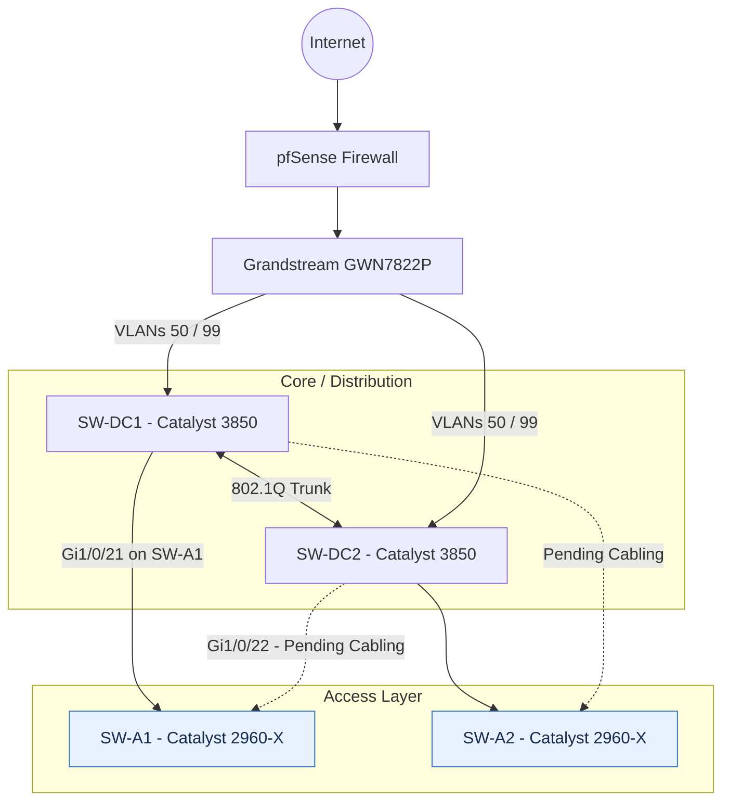
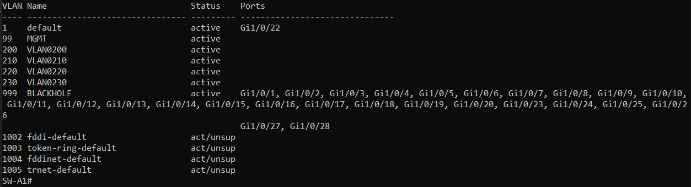
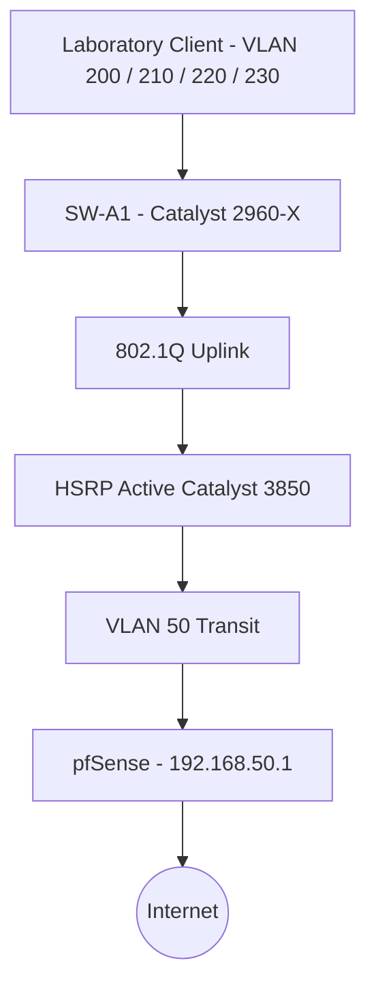
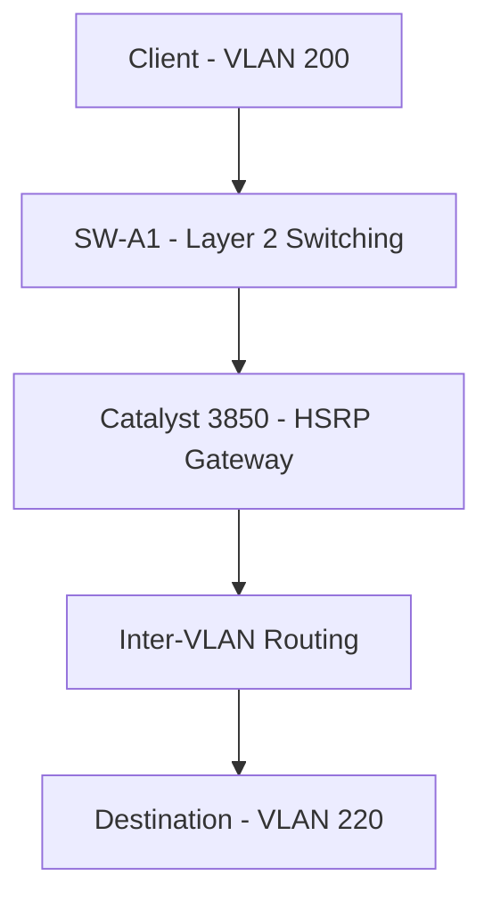
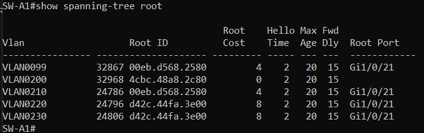
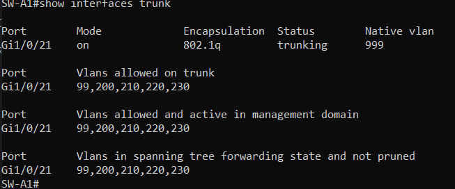
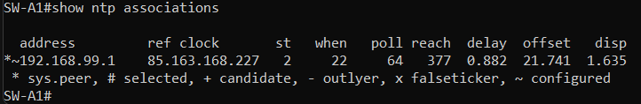
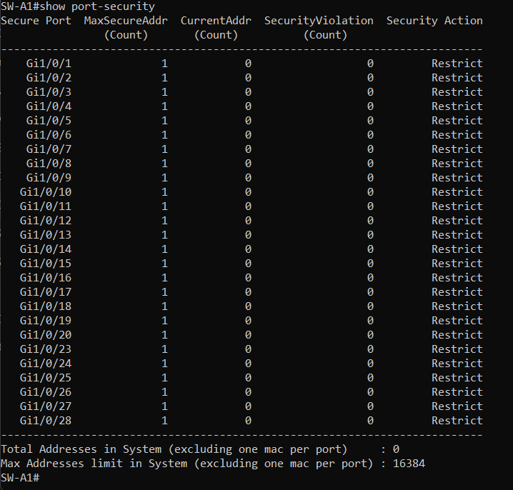

# Cisco Catalyst 2960-X — SW-A1

## Overview

**SW-A1** is one of two Cisco Catalyst 2960-X switches operating at the **Access Layer** of my homelab.

The infrastructure follows a simplified **Collapsed Core architecture**, where two Cisco Catalyst 3850 switches provide Layer 3 routing, HSRP gateway redundancy, and Rapid-PVST+ root distribution.

SW-A1 provides Layer 2 switching, VLAN segmentation, redundant uplink capabilities, dedicated management connectivity, and access-layer security features.

> **Configuration Lifecycle:** This documentation represents the initial configuration of SW-A1. It will evolve as additional networking labs, security features, monitoring solutions, and infrastructure improvements are implemented.

---

## Network Topology

The Cisco laboratory consists of two Catalyst 3850 core/distribution switches and two Catalyst 2960-X access switches.

SW-A1 is designed with two 802.1Q uplinks toward SW-DC1 and SW-DC2, providing redundant Layer 2 paths to the core infrastructure.

One uplink is connected, while the second uplink is configured and awaiting an additional Ethernet cable.

Solid links represent deployed connections. Dashed links indicate connections awaiting cabling.

The final topology will be updated when all four access-to-distribution links have been connected and verified.

---

## VLAN Architecture & IP Addressing

### Infrastructure VLANs

| VLAN | Purpose | Configuration |
|---|---|---|
| 99 | Infrastructure Management | 192.168.99.20/24 |
| 999 | Blackhole / Native VLAN | No Layer 3 interface |

### Laboratory VLANs

| VLAN | Network | HSRP Gateway | Preferred Active |
|---|---|---|---|
| 200 | 192.168.200.0/24 | 192.168.200.1 | SW-DC1 |
| 210 | 192.168.210.0/24 | 192.168.210.1 | SW-DC1 |
| 220 | 192.168.220.0/24 | 192.168.220.1 | SW-DC2 |
| 230 | 192.168.230.0/24 | 192.168.230.1 | SW-DC2 |

The laboratory VLANs are permitted on the uplink trunks, while inter-VLAN routing is handled by the Catalyst 3850 core/distribution switches.

SW-A1 operates as a Layer 2 switch and uses VLAN 99 for management connectivity.

**CLI Screenshot — VLAN Configuration**

---

## Layer 2 Switching

SW-A1 operates at Layer 2 and forwards Ethernet frames based on learned MAC addresses.

Traffic within the same VLAN is switched locally when the destination is reachable through the switch.

Traffic destined for another VLAN is forwarded toward the Catalyst 3850 core, where Layer 3 routing is performed.

### Outbound Traffic Flow

### Inter-VLAN Traffic Flow

The Catalyst 3850 switches provide the routing services, while SW-A1 extends Layer 2 connectivity to laboratory devices.

---

## Spanning Tree

SW-A1 uses **Rapid-PVST+** to participate in the Cisco laboratory's Layer 2 topology.

The preferred Root Bridges are located at the Catalyst 3850 core/distribution layer.

| VLAN | Preferred Root Bridge |
|---|---|
| 200 | SW-DC1 |
| 210 | SW-DC1 |
| 220 | SW-DC2 |
| 230 | SW-DC2 |

### PortFast & BPDU Guard

PortFast and BPDU Guard are configured globally for eligible access ports:

- **PortFast:** Allows edge ports to transition rapidly to the forwarding state.
- **BPDU Guard:** Protects PortFast-enabled access ports by err-disabling them when unexpected BPDUs are received.

Both features are explicitly disabled on the uplink trunks toward SW-DC1 and SW-DC2.

This separates end-device access behavior from switch-to-switch connectivity.

**CLI Screenshot — STP Root Verification**

---

## Trunk Configuration

SW-A1 uses manually configured 802.1Q trunks toward both Catalyst 3850 core/distribution switches.

| Interface | Connection | Allowed VLANs | Native VLAN | Status |
|---|---|---|---|---|
| Gi1/0/21 | SW-DC1 | 99, 200, 210, 220, 230 | 999 | Connected |
| Gi1/0/22 | SW-DC2 | 99, 200, 210, 220, 230 | 999 | Pending cabling |

Both trunk interfaces use `switchport mode trunk` and `switchport nonegotiate`.

DTP negotiation, PortFast, and BPDU Guard are disabled on these switch-to-switch links.

The dedicated native VLAN 999 is used instead of the default VLAN 1.

**CLI Screenshot — Trunk Verification**

The second uplink will be verified after the missing Ethernet cable has been installed.

---

## Management & NTP

SW-A1 is managed through the dedicated VLAN 99.

| Service | Configuration |
|---|---|
| Management IP | `192.168.99.20/24` |
| Management VLAN | 99 |
| Default Gateway | `192.168.99.1` |
| Management Access | SSH |
| Authentication | Local |
| NTP Server | `192.168.99.1` |
| Time Zone | CET (UTC+1, fixed offset) |

The management SVI provides IP connectivity for administration, while pfSense acts as the management gateway and configured NTP server.

Remote CLI administration uses local authentication and SSH-only access.

**CLI Screenshot — NTP Synchronization**

---

## Security & Hardening

### Implemented

SW-A1 includes several initial Layer 2 security and switch hardening mechanisms:

- **VLAN 999 Blackhole:** Unused access ports assigned to a dedicated isolated VLAN.
- **Administrative Shutdown:** Unused physical interfaces administratively disabled using `shutdown`.
- **Port Security:** Enabled on unused access interfaces, using Sticky MAC learning and `restrict` violation mode.
- **PortFast:** Enabled by default for eligible access interfaces.
- **BPDU Guard:** Enabled globally for PortFast-enabled interfaces.
- **DTP Hardening:** Dynamic trunk negotiation disabled on manually configured trunks.
- **Native VLAN Hardening:** VLAN 999 used as a dedicated, non-user native VLAN on uplink trunks.
- **SSH Management:** Remote CLI administration restricted to SSH.
- **VLAN 1 SVI Disabled:** The default VLAN 1 management SVI is administratively disabled.

### Port Security

Port Security is configured on unused access interfaces with the following mechanisms:

- Sticky MAC address learning
- Violation mode `restrict`
- Port Security enabled on access ports

The default maximum of one secure MAC address applies unless explicitly changed.

Unused access interfaces remain administratively disabled until required for laboratory devices.

Port Security policies will be adapted when connecting PCs, IP phones, or other devices that may require multiple MAC addresses.

**CLI Screenshot — Port Security Verification**

### Planned Security Improvements

| Feature | Status |
|---|---|
| DHCP Snooping | Planned |
| Dynamic ARP Inspection | Planned |
| Storm Control | Planned |
| Additional Access Port Policies | Planned |
| Syslog / Monitoring | Planned |

These features will be progressively implemented and documented through practical laboratory exercises.

---

## Current Status & Next Steps

| Component | Status |
|---|---|
| VLAN 99 Management SVI | Configured |
| Layer 2 Switching | Configured |
| Rapid-PVST+ | Configured |
| PortFast / BPDU Guard | Configured |
| 802.1Q Uplinks | Configured |
| Second Uplink | Pending cabling |
| Native VLAN 999 | Configured on uplinks |
| Port Security | Configured on access ports |
| SSH | Configured |
| NTP | Configured |
| Blackhole VLAN / Unused Port Shutdown | Configured |
| DHCP Snooping | Planned |
| Dynamic ARP Inspection | Planned |
| Storm Control | Planned |
| Syslog / Monitoring | Planned |

The next stage will focus on completing physical uplink redundancy, activating laboratory access ports, validating Spanning Tree behavior, and implementing advanced Layer 2 security features.

---

## Configuration Files

A sanitized version of the switch configuration can be included in this repository.

Sensitive information, including authentication credentials, password hashes, and unnecessary system-generated sections, must be removed before publication.

The published configuration is intended for technical documentation and is not a complete restorable device backup.

**Sanitized running configuration:** [View SW-A1 show running-config](Configs/show_running-config_SW-A1.txt)

---

## Conclusion

The initial configuration of **SW-A1** establishes the Layer 2 access infrastructure of my Cisco networking laboratory.

It combines VLAN segmentation, 802.1Q trunking, Rapid-PVST+, PortFast, BPDU Guard, Port Security, dedicated management connectivity, SSH administration, NTP configuration, and basic switch hardening.

SW-A1 is designed to connect to both Catalyst 3850 core/distribution switches, providing redundant Layer 2 paths once the remaining physical uplink is installed.

The next phase will focus on integrating laboratory clients, validating the redundant topology, configuring additional security mechanisms, and expanding the Cisco access layer.

**This homelab is an evolving learning environment.** Configurations and documentation will be updated as new technologies are deployed, tested, and improved.