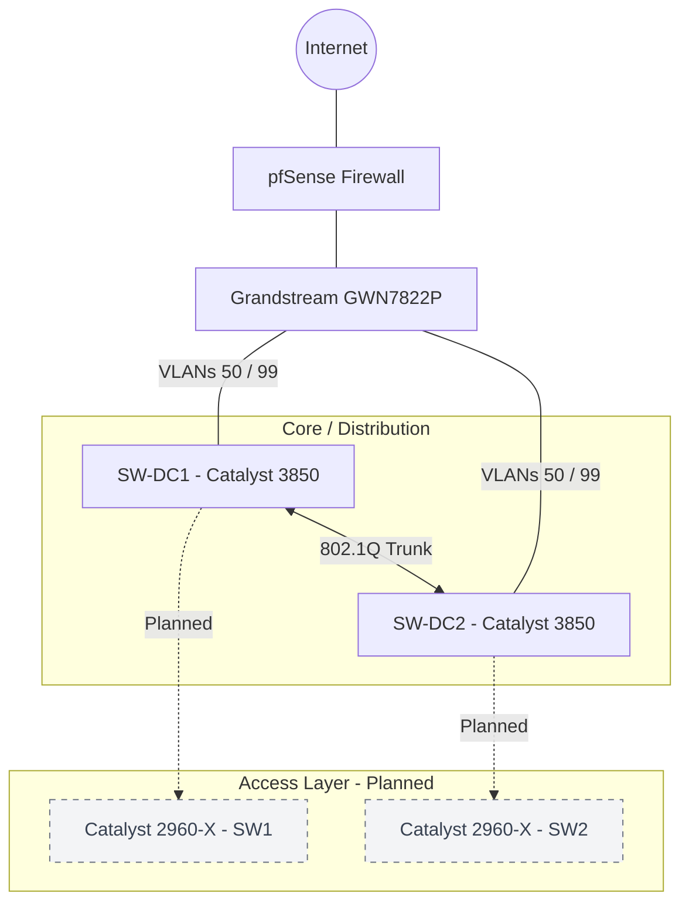
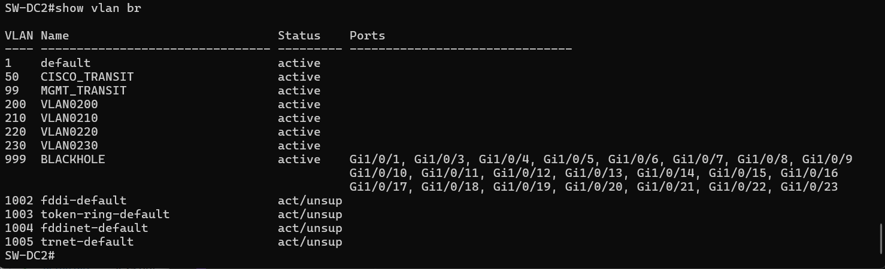
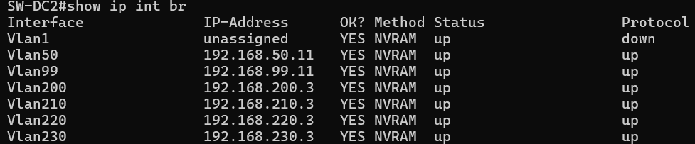
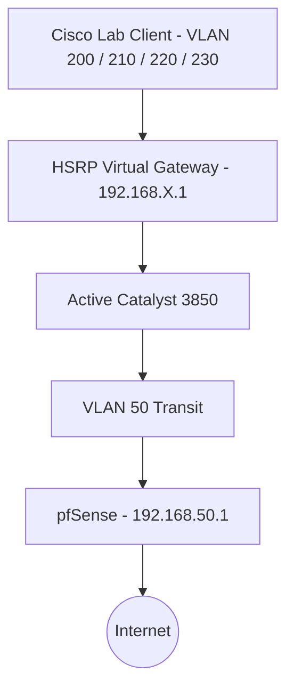
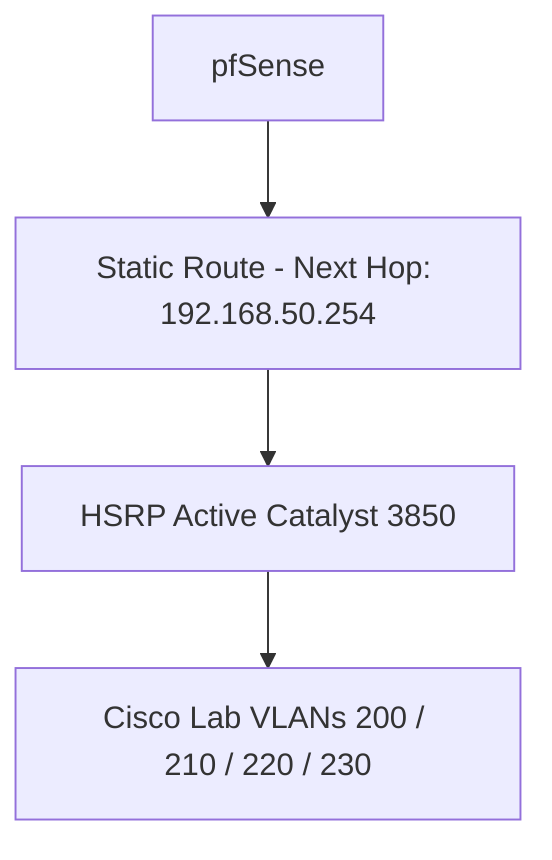
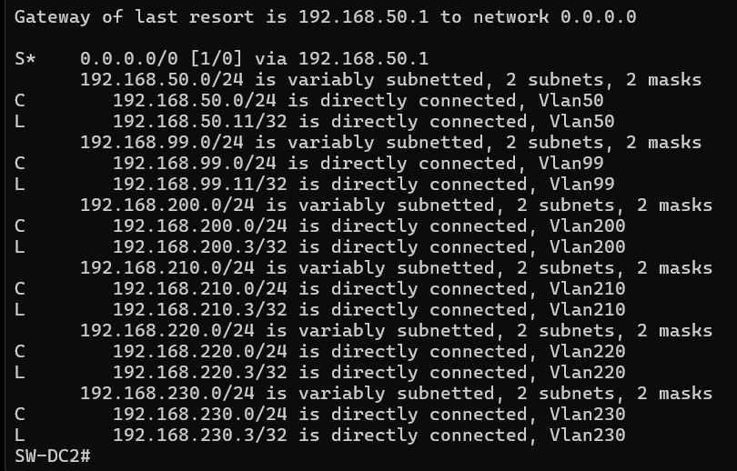
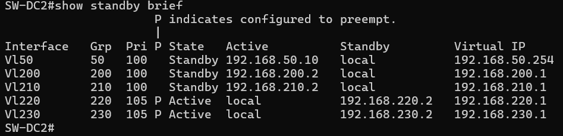
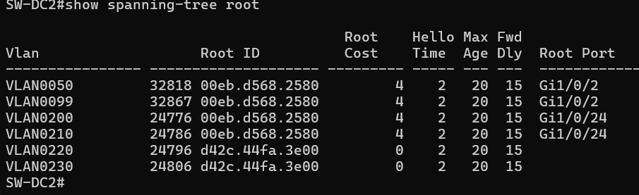
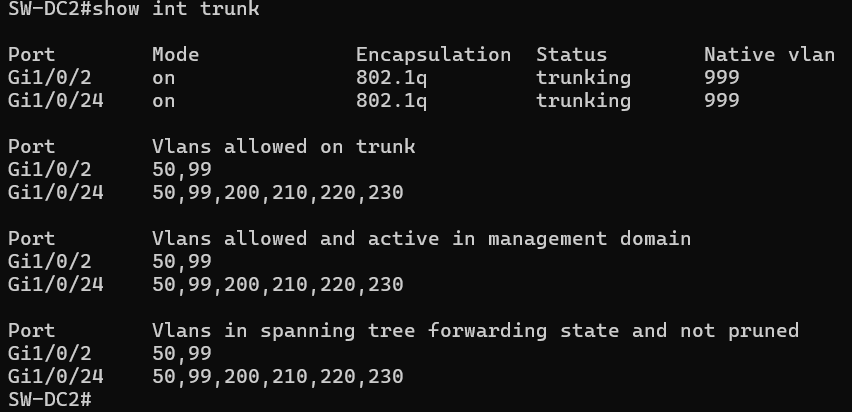
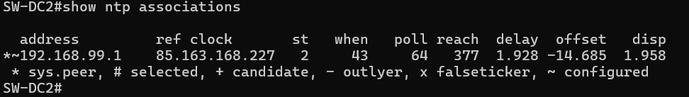

# Cisco Catalyst 3850 — SW-DC2

## Overview

**SW-DC2** is the second Cisco Catalyst 3850 switch operating at the **Core / Distribution layer** of my homelab.

The infrastructure follows a simplified **Collapsed Core architecture**, providing Layer 3 switching, inter-VLAN routing, HSRP gateway redundancy, Rapid-PVST+, and dedicated management connectivity.

SW-DC2 complements SW-DC1 by acting as the preferred HSRP Active router for VLANs 220 and 230.

> **Configuration Lifecycle:** This documentation represents the initial configuration. It will evolve as additional networking labs, security features, monitoring solutions, and infrastructure improvements are implemented.

---

## Network Topology

The current infrastructure consists of two Catalyst 3850 switches connected to the Grandstream GWN7822P, providing upstream connectivity toward pfSense.

The Catalyst 2960-X access layer is planned but not yet physically connected due to insufficient Ethernet cabling.

Solid links represent the current infrastructure. Dashed links indicate planned connections.

The README will be updated when the Catalyst 2960-X switches are connected, configured, and documented.

---

## VLAN Architecture & IP Addressing

### Infrastructure VLANs

| VLAN | Purpose | SW-DC1 | SW-DC2 | pfSense | HSRP VIP |
|---|---|---|---|---|---|
| 50 | Transit | 192.168.50.10 | 192.168.50.11 | 192.168.50.1 | 192.168.50.254 |
| 99 | Management | 192.168.99.10 | 192.168.99.11 | 192.168.99.1 | — |
| 999 | Blackhole / Native VLAN | — | — | — | — |

### Laboratory VLANs

| VLAN | Network | DC1 SVI | DC2 SVI | HSRP Gateway | Preferred Active |
|---|---|---|---|---|---|
| 200 | 192.168.200.0/24 | .2 | .3 | .1 | DC1 |
| 210 | 192.168.210.0/24 | .2 | .3 | .1 | DC1 |
| 220 | 192.168.220.0/24 | .2 | .3 | .1 | DC2 |
| 230 | 192.168.230.0/24 | .2 | .3 | .1 | DC2 |

All listed routed VLANs use a `/24` subnet mask.

**CLI Screenshot — VLAN Configuration**

**CLI Screenshot — Layer 3 Interfaces**

---

## Layer 3 Routing

Inter-VLAN routing is performed directly by the Catalyst 3850 switches.

SW-DC2 uses a static default route toward pfSense at `192.168.50.1`.

For return traffic, pfSense uses the HSRP transit virtual IP `192.168.50.254` as the next hop toward the Cisco laboratory networks.

### Outbound Traffic Flow

### Return Traffic Flow

**CLI Screenshot — Routing Table**

**Screenshot — pfSense Static Routes**

---

## HSRP Redundancy

HSRP version 2 is configured on both Catalyst 3850 switches to provide redundant virtual gateways.

- **VLANs 200/210:** DC1 is the preferred Active router.
- **VLANs 220/230:** DC2 is the preferred Active router.
- **VLAN 50:** Virtual IP `192.168.50.254` provides a redundant next hop for pfSense.

On SW-DC2, HSRP priority 105 and preemption are configured for VLANs 220 and 230. The remaining HSRP interfaces use the default priority of 100.

**CLI Screenshot — HSRP Status**

---

## Spanning Tree

The infrastructure uses **Rapid-PVST+**, with STP priorities aligned to the preferred HSRP Active router distribution.

| VLAN | Preferred HSRP Active | Preferred STP Root |
|---|---|---|
| 200 | DC1 | DC1 |
| 210 | DC1 | DC1 |
| 220 | DC2 | DC2 |
| 230 | DC2 | DC2 |

On SW-DC2:

- VLANs 200/210: STP priority `28672`
- VLANs 220/230: STP priority `24576`

**CLI Screenshot — STP Root Verification**

---

## Trunk Configuration

| Interface | Connection | Allowed VLANs | DTP |
|---|---|---|---|
| Gi1/0/2 | Grandstream | 50, 99 | Disabled |
| Gi1/0/24 | DC1 | 200, 210, 220, 230 | Disabled |

Both trunk interfaces use manual trunk configuration with `switchport nonegotiate`.

VLANs 50 and 99 are carried through the Grandstream uplink, while the inter-switch trunk carries the laboratory VLANs.

Additional trunks toward the Catalyst 2960-X access switches will be documented after physical deployment.

**CLI Screenshot — Trunk Verification**

---

## Management & NTP

SW-DC2 is managed through VLAN 99.

| Service | Configuration |
|---|---|
| Management IP | `192.168.99.11/24` |
| Management Access | SSH |
| Authentication | Local |
| NTP Server | `192.168.99.1` |
| Upstream Gateway | `192.168.50.1` |

SW-DC2 uses pfSense as its configured NTP server.

**CLI Screenshot — NTP Synchronization**

---

## Security & Hardening

### Implemented

Basic switch hardening has already been applied:

- **VLAN 999 Blackhole:** Unused access ports assigned to an isolated VLAN.
- **Administrative Shutdown:** Unused access interfaces disabled using `shutdown`.
- **DTP Hardening:** Dynamic trunk negotiation disabled on manually configured trunks.
- **SSH Management:** Remote CLI administration through SSH.
- **Native VLAN Hardening:** Changed the native VLAN from the default VLAN 1 to a dedicated, unused VLAN 999 on all 802.1Q trunk links to reduce VLAN hopping risks.

### Planned Security Improvements

| Feature | Status |
|---|---|
| Port Security | Planned |
| DHCP Snooping | Planned |
| Dynamic ARP Inspection | Planned |
| ACLs | Planned |
| BPDU Guard | Planned |

These features will be progressively implemented and documented in future labs.

---

## Current Status & Next Steps

| Component | Status |
|---|---|
| VLANs / SVIs / Inter-VLAN Routing | Configured |
| HSRP | Configured |
| Rapid-PVST+ | Configured |
| Static Routing | Configured |
| SSH / NTP | Configured |
| Basic Switch Hardening | Implemented |
| Native VLAN 999 | Configured |
| Catalyst 2960-X Access Layer | Pending cabling |
| Advanced Layer 2 Security | Planned |
| OSPF | Planned |
| Syslog / Monitoring | Planned |

---

## Configuration Files

A sanitized version of the switch configuration is included in this repository.

Sensitive information, including authentication credentials, password hashes and unnecessary system-generated sections, has been intentionally omitted.

The published configuration is intended for technical documentation and is not a complete restorable device backup.

**Sanitized running configuration:** [View SW-DC2 show running-config](Configs/show_running-config_SW-DC2.txt)

---

## Conclusion

This initial configuration establishes the complementary role of **SW-DC2** within my Cisco collapsed-core network, combining Layer 3 switching, inter-VLAN routing, HSRP redundancy, Rapid-PVST+, infrastructure management and basic security hardening.

SW-DC2 acts as the preferred HSRP Active router for VLANs 220 and 230, with Spanning Tree priorities aligned to the gateway distribution strategy.

The next phase will focus on integrating the Catalyst 2960-X access layer, implementing additional security controls, introducing OSPF and expanding monitoring capabilities.

**This homelab is an evolving learning environment.** Configurations and documentation will be updated as new technologies are deployed, tested and improved.