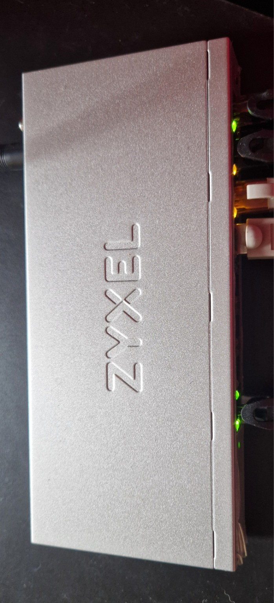

# Zyxel GS1200-8HP v3

## Acquisition

- **Model:** Zyxel GS1200-8HP v3
- **Condition:** New
- **Ethernet:** 8 × 1 GbE ports
- **PoE:** 4 × PoE+ ports (802.3at)
- **Management:** Web-based interface
- **VLAN Support:** IEEE 802.1Q

---

## Why I Chose This Switch

Unlike most of the equipment in my homelab, the Zyxel GS1200-8HP v3 wasn't originally part of my network infrastructure plan.

My initial intention was to connect all my devices directly to the main Grandstream GWN7822P switch.

However, as the project evolved, I realized that I needed an additional switch to connect several devices in my living room without running a separate Ethernet cable for each one.

I also needed a way to power my Grandstream GWN7660E wireless access point using PoE.

The Zyxel provided a practical solution to both problems.

### Main Reasons for Choosing This Switch

- **8 Gigabit Ethernet ports:** Enough connectivity for my family network devices.
- **PoE+ support:** Allows me to power my Grandstream GWN7660E without a separate power adapter.
- **VLAN support:** Enables integration into my existing network segmentation.
- **Web management:** Provides an interface for configuring ports, VLANs and other Layer 2 features.
- **Compact design:** Easy to install in my living room.
- **Cost efficiency:** Avoids purchasing a more expensive switch with features I don't currently need.

### Why a Managed Switch?

Although the Zyxel primarily serves my family network, I wanted to maintain the same VLAN segmentation principles used throughout my homelab.

An unmanaged switch would have provided additional Ethernet connectivity, but a managed switch gives me more control over VLAN membership, tagged and untagged traffic, and management access.

**My objective was to extend the network without compromising its logical segmentation.**

---

## Role in My Homelab

The Zyxel GS1200-8HP v3 operates as an additional Layer 2 access switch.

Its primary responsibilities are:

- Connecting wired devices belonging to **VLAN 10 (Family Network)**.
- Providing PoE connectivity to my Grandstream GWN7660E access point.
- Extending the network through a single Ethernet uplink to the Grandstream GWN7822P.
- Maintaining VLAN separation through IEEE 802.1Q tagging.
- Providing additional managed-switch configuration experience.

---

## Initial Configuration

The initial configuration focused on integrating the Zyxel into my existing VLAN architecture while maintaining connectivity for my family devices.

---

## Observations

### Integration

Once the VLAN configuration was corrected, the Zyxel integrated into my existing network infrastructure.

It provides additional Ethernet connectivity without requiring each living room device to connect directly to the main rack.

### PoE

The ability to power my Grandstream GWN7660E directly from the switch is particularly convenient.

It reduces the number of power adapters and simplifies cable management.

### Network Segmentation

The switch allows my family devices to remain within their assigned VLAN while my homelab infrastructure continues to use separate networks.

This is particularly useful because I frequently experiment with networking, routing and security configurations.

Keeping the family network logically separated helps me organize the infrastructure and apply appropriate security policies.

---

## Future Improvements

As my homelab evolves, I plan to continue improving the network infrastructure.

Potential improvements include:

- Reviewing VLAN and management access security.
- Documenting the final port-to-VLAN mapping.
- Backing up switch configurations.
- Testing additional Layer 2 features.
- Improving the physical cable management.
- Expanding wireless segmentation with a dedicated guest network.

---

## Conclusion

The Zyxel GS1200-8HP v3 was an unplanned addition to my homelab, but it became a useful part of my network infrastructure.

It provides the additional connectivity needed for my family devices while supplying PoE power to my Grandstream wireless access point.

More importantly, its configuration gave me another opportunity to apply the networking concepts I studied during my CCNA preparation.

Working with the Zyxel and Grandstream switches also allowed me to gain practical experience with VLANs across different manufacturers.

**This deployment taught me that building a network is not only about selecting hardware, but also about adapting the architecture to real-world requirements and troubleshooting unexpected configuration challenges.**

For my current needs, the Zyxel provides the connectivity, flexibility and management features I was looking for.