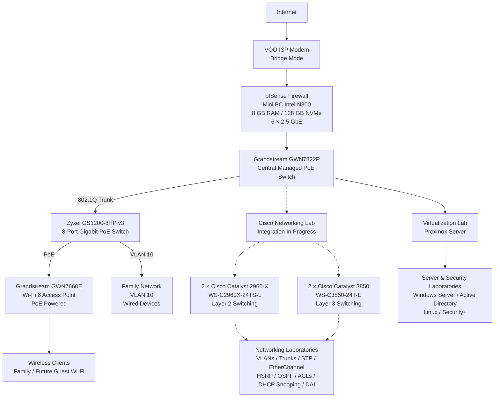

# 🏠 Homelab Infrastructure Project

This repository documents the design, deployment, operation, and evolution of my personal IT homelab.

The project was created to move beyond simulated environments such as Cisco Packet Tracer and GNS3 and apply the networking knowledge acquired through my CompTIA Network+ and Cisco CCNA studies to real enterprise hardware.

The environment is built around Cisco switching, Grandstream, Zyxel, pfSense, Proxmox, Windows Server, Active Directory, and Linux.

The core physical and network infrastructure is now operational, while advanced networking, virtualization, and security laboratories continue to evolve.

Its purpose is not only to build a working infrastructure, but to document the complete engineering process:

**design → deployment → verification → troubleshooting → improvement**

The homelab also serves as a practical platform for my Security+ preparation and future CCNP studies.

---

## 🚧 Current status

**Core Infrastructure Operational – Lab Expansion in Progress**

The core homelab infrastructure is now deployed and operational.

Internet connectivity, routing, firewalling, VLAN segmentation, wired and wireless access, and the Proxmox virtualization host are established.

The project is now transitioning from initial infrastructure deployment to advanced networking, virtualization, systems administration, and security laboratories.

### ✅ Completed

- ✅ [First Cisco Catalyst 2960-X acquired and validated](Materials/Cisco-Switchs/Cisco-2960x-1/README.md)
- ✅ [Second Cisco Catalyst 2960-X acquired and validated](Materials/Cisco-Switchs/Cisco-2960x-2/README.md)
- ✅ [First Cisco Catalyst 3850 acquired and validated](Materials/Cisco-Switchs/Cisco-3850-1/README.md)
- ✅ [Second Cisco Catalyst 3850 acquired and validated](Materials/Cisco-Switchs/Cisco-3850-2/README.md)
- ✅ [Grandstream GWN7822P deployed](Materials/Grandstream/README.md)
- ✅ [Grandstream GWN7660E Wi-Fi 6 access point deployed](Materials/Grandstream%20AP/README.md)
- ✅ [Zyxel GS1200-8HP v3 deployed](Materials/Zyxel/README.md)
- ✅ [pfSense firewall/router deployed](Materials/Mini-PC%20Pfsense/README.md)
- ✅ [GMKtec K8 Plus Proxmox host deployed](Materials/Mini-PC%20Proxmox/README.md)
- ✅ [15U Lanberg rack installed](Materials/Rack/README.md)
- ✅ [Atlantis A03-HP2003 UPS installed](Materials/UPS/README.md)
- ✅ VOO GigaMax modem configured in bridge mode
- ✅ pfSense configured as the main router and firewall
- ✅ NAT and internet connectivity operational
- ✅ VLAN-based network segmentation implemented
- ✅ Family Network (VLAN 10) operational
- ✅ Management Network (VLAN 99) configured
- ✅ Grandstream and Zyxel switch connectivity established
- ✅ Wi-Fi 6 connectivity operational
- ✅ PoE connectivity established for the wireless access point
- ✅ Inter-VLAN routing and firewall policies implemented
- ✅ Proxmox host installed and management access configured
- ✅ Windows Server and Active Directory labs started on Hyper-V

### 🔄 In progress

- 🔄 Cisco Catalyst 3850 and 2960-X laboratory integration
- 🔄 Advanced Layer 2 and Layer 3 networking laboratories
- 🔄 Proxmox virtual networking and virtual machine deployment
- 🔄 Firewall policy refinement and network security hardening
- 🔄 Repository structure and technical documentation
- 🔄 Network diagrams and configuration documentation
- 🔄 Final cable management and rack optimization
- 🔄 Homelab architecture improvements

### 📋 Planned

- 📋 Windows Server and Active Directory deployment on Proxmox
- 📋 Group Policy (GPO) laboratories
- 📋 Linux server administration laboratories
- 📋 Advanced dynamic routing laboratories
- 📋 HSRP, STP, and EtherChannel laboratories
- 📋 Dedicated guest wireless network
- 📋 Centralized network monitoring and logging
- 📋 Backup and recovery strategy
- 📋 Advanced network security and traffic analysis laboratories

---

## 🎯 Objectives

The main objectives of this homelab are to:

- Apply CCNA networking knowledge on physical enterprise hardware
- Design and operate a segmented multi-VLAN network
- Practice Layer 2 and Layer 3 networking
- Implement and understand inter-VLAN routing
- Deploy and manage routing, firewalling, and NAT with pfSense
- Practice structured network troubleshooting
- Deploy Windows Server, Active Directory, and Linux services
- Learn and practice virtualization with Proxmox
- Build a secure remote administration environment
- Apply network security features on real equipment
- Document configurations, failures, troubleshooting, and solutions
- Support future CCNP and ongoing Security+ studies

---

## 🗺️ Target architecture

The core network infrastructure is operational and provides the foundation for the Cisco networking, virtualization, and security laboratories.

The following diagram represents the current core infrastructure and the planned laboratory environment.



**Diagram legend:**

- **Solid lines:** Deployed core network infrastructure and connectivity.
- **Dashed lines:** Planned or ongoing laboratory integration.

### Component roles

| Component | Role |
|---|---|
| **VOO ISP Modem** | Provides internet connectivity in bridge mode, allowing pfSense to operate as the main router and firewall |
| **pfSense Mini PC** | Main firewall, inter-VLAN routing, NAT, VLAN gateways, and network security |
| **Grandstream GWN7822P** | Central managed switch connecting the family network, management infrastructure, Proxmox host, and future Cisco laboratory |
| **Grandstream GWN7660E** | Wi-Fi 6 access point providing wireless connectivity for family devices (VLAN 10) and supporting future guest networks, powered via PoE by the Zyxel switch |
| **Zyxel GS1200-8HP v3** | Managed Gigabit PoE switch extending the family network (VLAN 10), powering the Grandstream Wi-Fi 6 access point, and connecting to the main Grandstream switch through an 802.1Q trunk |
| **2 × Cisco Catalyst 2960-X WS-C2960X-24TS-L** | Layer 2 laboratory switches for VLANs, trunks, STP, EtherChannel, Port Security, DHCP Snooping, and DAI |
| **2 × Cisco Catalyst 3850 WS-C3850-24T-E** | Layer 3 laboratory switches for inter-VLAN routing, HSRP, OSPF, ACLs, and advanced switching/routing laboratories |
| **Proxmox Server** | Operational virtualization host used to build Windows Server, Active Directory, Linux, security, and infrastructure laboratories |

> The core infrastructure is operational. The architecture continues to evolve as additional servers, virtual machines, clients, network services, and Cisco laboratories are integrated.

---

## 🌐 Network segmentation

The network uses VLAN-based segmentation to separate family devices, management traffic, and laboratory environments.

### VLAN design

| VLAN | Purpose | Status |
|---|---|---|
| VLAN 10 | Family network | Operational |
| VLAN 50 | Cisco / Homelab network | Planned laboratory integration |
| VLAN 99 | Management | Configured |
| VLAN 100 | Virtualization / servers | Configuration and integration in progress |
| VLAN 999 | Blackhole / unused ports | Planned security practice |

pfSense handles routing and firewall policies between the main network segments.

The Cisco Catalyst 3850 switches are intended to provide additional Layer 3 routing within the Cisco laboratory environment, including static routing, dynamic routing protocols, and first-hop redundancy.

The Grandstream GWN7822P and Zyxel GS1200-8HP v3 operate primarily as Layer 2 switches within the core home network.

### Segmentation objectives

The main goal is to isolate the laboratory environment from the family network while allowing controlled internet access and authorized management traffic.

The segmentation also allows me to:

- Separate family devices from experimental networking environments
- Restrict administrative access to network equipment
- Apply dedicated firewall rules between VLANs
- Test network security policies
- Build additional isolated virtual and physical networks
- Experiment with routing without disrupting the family network

---

## 🖥️ Hardware

Each major device has its own documentation folder under `Materials/`.

The status below distinguishes deployed infrastructure from hardware acquired for the Cisco laboratory.

| Status | Device | Role |
|---|---|---|
| ✅ Validated | Cisco Catalyst WS-C2960X-24TS-L #1 | Layer 2 access switch |
| ✅ Validated | Cisco Catalyst WS-C2960X-24TS-L #2 | Layer 2 access switch |
| ✅ Validated | Cisco Catalyst 3850 #1 | Layer 3 distribution / collapsed-core |
| ✅ Validated | Cisco Catalyst 3850 #2 | Layer 3 distribution / collapsed-core |
| ✅ Deployed | Grandstream GWN7822P | Central VLAN switching |
| ✅ Deployed | Mini PC — pfSense | Firewall / router |
| ✅ Deployed | Mini PC — Proxmox | Virtualization host |
| ✅ Installed | 15U Lanberg rack | Physical infrastructure |
| ✅ Installed | Atlantis A03-HP2003 | UPS / Power Protection |
| ✅ Deployed | Grandstream GWN7660E | Wi-Fi 6 Access Point |
| ✅ Deployed | Zyxel GS1200-8HP v3 | Family Network / PoE Switch |

Smaller accessories such as console cables, patch cables, keystone modules, and patch-panel components are documented separately under `Materials/Accessory/`.

---

## 🧱 Cisco lab

The Cisco lab provides a physical environment for practicing and extending the networking concepts studied through CCNA and future CCNP work.

Four Cisco Catalyst switches have been acquired and validated:

- 2 × Cisco Catalyst 2960-X
- 2 × Cisco Catalyst 3850

Their integration into the homelab architecture is currently in progress.

### Main areas

- Layer 2 switching: VLANs, trunking, STP/RPVST+, EtherChannel
- Layer 2 security: Port Security, DHCP Snooping, DAI, BPDU Guard
- Layer 3 networking: inter-VLAN routing, static and dynamic routing, IPv4/IPv6
- First-hop redundancy: HSRP for IPv4 and HSRP for IPv6
- Network architecture: access/distribution roles and collapsed-core design
- Management and hardening: SSH, management VLANs, device security
- Troubleshooting, validation, redundancy, and failover testing

The Cisco laboratory will operate alongside the existing pfSense-based infrastructure while allowing additional routing and switching scenarios to be tested.

The long-term objective is to reuse the same physical infrastructure for more advanced CCNP-oriented labs.

---

## 🖥️ Virtualization and systems lab

The virtualization and systems lab is designed to deploy, integrate, and troubleshoot Windows and Linux environments.

The GMKtec K8 Plus Proxmox host is installed and operational.

The virtualization platform provides the foundation for deploying additional virtual machines, isolated virtual networks, and infrastructure services.

Windows Server and Active Directory laboratory work has also been started separately using Hyper-V.

### Main areas

- Proxmox virtualization and virtual networking
- Windows Server and Active Directory
- Windows client integration and Group Policy
- Linux server administration
- DNS, DHCP, file services, and authentication
- Logging, monitoring, backups, and security
- Integration with the physical VLAN infrastructure
- Structured systems troubleshooting

### Current focus

The next steps involve expanding the Proxmox environment, configuring additional virtual networks, and deploying infrastructure services.

The objective is to connect physical networking concepts with virtualized systems administration and security laboratories.

---

## 📚 Documentation approach

Documentation is intentionally separated into two areas.

### `Materials/`

The `Materials/` directory acts as the equipment identity card.

Each device folder may contain:

- Why the equipment was selected
- Acquisition information
- Physical condition
- Initial inspection
- Software version
- Hardware verification
- Photos
- Current status

Example:

```text
Materials/
└── Cisco-Switchs/
    └── Cisco-2960x-1/
        ├── README.md
        └── Pictures/
```

### `Labs/`

The lab folders document what is actually built with the equipment.

Each lab follows a consistent structure:

1. **Objective**
2. **Topology**
3. **Configuration**
4. **Verification**
5. **Troubleshooting**
6. **Solution**
7. **Lessons learned**

Failed attempts are documented alongside successful implementations.

The goal is to show the real engineering process rather than only the final working configuration.

---

## 🔐 Security principles

### Infrastructure

The homelab is designed and operated with security in mind.

The core infrastructure already uses VLAN segmentation, pfSense firewall policies, and dedicated network management.

Current and planned security practices include:

- SSH-based administration
- Avoiding Telnet for device administration
- Dedicated management VLAN
- Local authentication
- Firewall policies
- Network segmentation
- DHCP Snooping
- Dynamic ARP Inspection
- Port Security
- BPDU Guard
- Secure device credentials
- Centralized logging
- Monitoring
- Controlled inter-VLAN communication
- Restricted management access
- Separation between family and lab networks

Some of these security features are already part of the operational infrastructure, while others will be implemented and tested in the Cisco and security laboratories.

### Repository

Sensitive information is never intentionally committed.

Repository rules include:

- No passwords
- No private keys
- No real public IP addresses
- No API tokens
- No sensitive credentials
- No unsanitized configuration backups
- Configuration files sanitized before publication
- Secrets checked before commits

---

## 📂 Repository structure

```text
Homelab/
│
├── README.md
├── CHANGELOG.md
├── .gitignore
│
├── Materials/
│   ├── Cisco-Switchs/
│   │   ├── Cisco-2960x-1/
│   │   ├── Cisco-2960x-2/
│   │   ├── Cisco-3850-1/
│   │   └── Cisco-3850-2/
│   ├── Grandstream/
│   ├── Grandstream AP/
│   ├── Zyxel/
│   ├── Mini-PC Pfsense/
│   ├── Mini-PC Proxmox/
│   ├── Rack/
│   ├── UPS/
│
├── Labs/
│   ├── Cisco/
│   └── Virtualization/
│
├── Configs/
│   ├── Cisco/
│   ├── pfSense/
│   └── Grandstream/
│
└── Troubleshooting/
```

> The repository structure evolves as new equipment, configurations, and laboratories are documented.

---

## 🛠️ Phase 1 — Network infrastructure

The core network infrastructure has been deployed successfully.

- [x] First Cisco Catalyst 2960-X acquired and validated
- [x] Second Cisco Catalyst 2960-X acquired and validated
- [x] First Cisco Catalyst 3850 acquired and validated
- [x] Second Cisco Catalyst 3850 acquired and validated
- [x] Grandstream GWN7822P switch deployed
- [x] Zyxel GS1200-8HP v3 deployed
- [x] Grandstream GWN7660E Wi-Fi 6 AP deployed
- [x] pfSense mini PC deployed
- [x] VOO GigaMax modem configured in bridge mode
- [x] 15U rack installed
- [x] Atlantis A03-HP2003 UPS installed
- [x] Core network architecture deployed
- [x] VLAN segmentation implemented
- [x] Family VLAN 10 operational
- [x] Management VLAN 99 configured
- [x] Inter-VLAN routing and firewall policies deployed
- [x] Wi-Fi 6 family network operational
- [x] PoE connectivity for wireless access point established
- [ ] Cisco lab fully integrated into the homelab
- [ ] Final rack and cable management completed

---

## 🖥️ Phase 2 — Virtualization and systems

The Proxmox virtualization host is operational, and the next phase focuses on deploying and integrating virtualized infrastructure services.

- [x] Windows Server and Active Directory labs started on Hyper-V (Laptop)
- [x] Proxmox host acquired
- [x] Proxmox virtualization platform installed and accessible
- [x] Proxmox management network configured
- [ ] Windows Server and Active Directory environment migrated to Proxmox
- [ ] Linux server environment deployed
- [ ] Virtualization lab fully integrated with the physical network
- [ ] Monitoring and centralized logging implemented
- [ ] Backup strategy implemented

---

## 🔐 Phase 3 — Advanced networking and security

The operational core infrastructure provides a foundation for more advanced networking and security experiments.

Future areas include:

- Advanced routing, redundancy, and high availability
- VPN, AAA, and centralized authentication
- Network monitoring, Syslog, and SNMP
- Network hardening and advanced firewall policies
- Network traffic analysis and security monitoring
- Automation, CCNP-oriented labs, and Security+-oriented labs

---

## 🧪 Troubleshooting philosophy

Troubleshooting is treated as an important part of the project.

Problems are documented whenever possible with:

- Symptoms
- Initial assumptions
- Verification commands
- Root cause
- Corrective action
- Final validation
- Lessons learned

The goal is not to hide failures, but to use them as part of the learning process.

The deployment of the core infrastructure has already provided practical troubleshooting experience involving network connectivity, VLAN configuration, switch management, firewall policies, and virtualization networking.

These experiences are part of the documentation process and help reinforce the theoretical knowledge acquired during my studies.

---

## 🚀 Project philosophy

This homelab is a long-term learning environment.

The core infrastructure is now operational, but the project continues to evolve through new laboratories, configurations, and technical challenges.

The objective is not to build everything at once, but to progressively design, deploy, test, break, troubleshoot, improve, and document the infrastructure.

The repository is therefore intended to show not only the final architecture, but also the decisions, mistakes, troubleshooting process, and lessons learned during the project.

**Core infrastructure operational — laboratories and documentation continuously evolving.**
