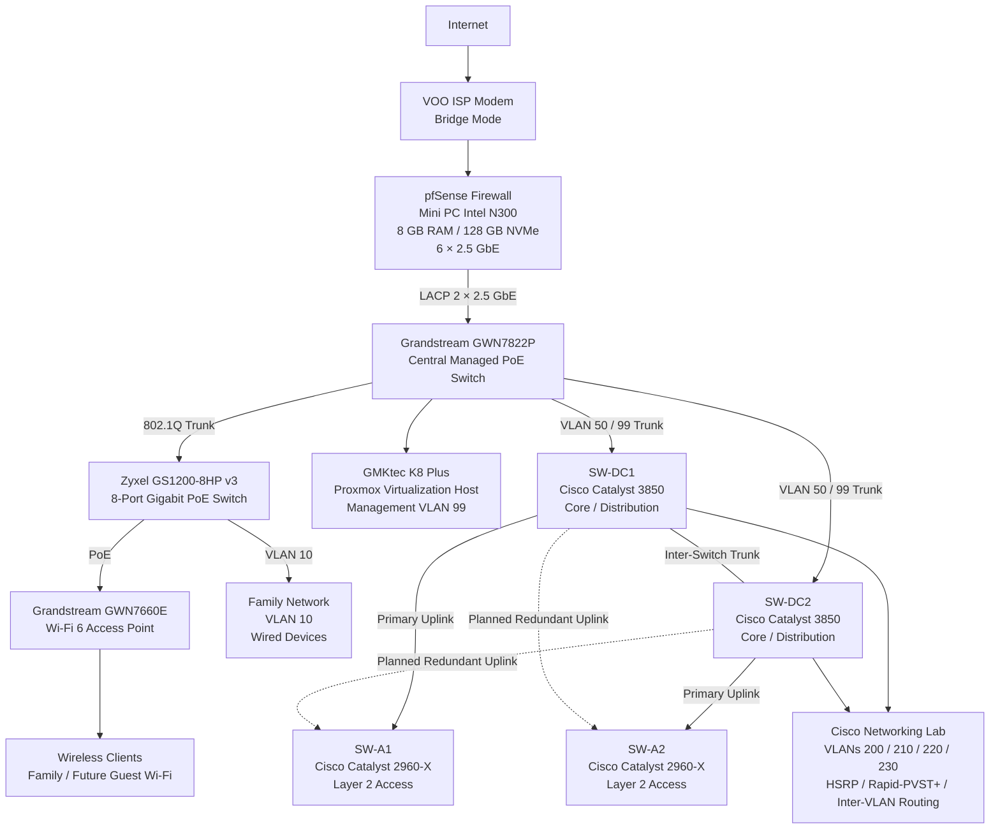

# 🏠 Homelab Infrastructure Project

This repository documents the design, deployment, operation and troubleshooting of my personal IT homelab, built on real enterprise hardware.

It was created to move beyond simulators such as Cisco Packet Tracer and GNS3 and to apply the knowledge from my CompTIA Network+ and Cisco CCNA certifications. It also serves as a platform for Security+ preparation and future CCNP studies.

The goal is to document the complete engineering process: **design → deployment → verification → troubleshooting → improvement**.

## ⭐ Highlights

- **Segmented multi-VLAN network** with a pfSense firewall/router, Grandstream and Zyxel switching, Wi-Fi 6 and a Proxmox virtualization host
- **Cisco collapsed-core lab** with two Catalyst 3850 and two Catalyst 2960-X switches: HSRP, Rapid-PVST+, inter-VLAN routing and SSH management
- **[Troubleshooting reports](Troubleshooting/README.md)** with evidence, root-cause analysis and lessons learned (LACP, IPv6)
- **Sanitized Cisco configurations:** [SW-DC1](Configs/Cisco/SW-DC1/README.md) · [SW-DC2](Configs/Cisco/SW-DC2/README.md) · [SW-A1](Configs/Cisco/SW-A1/README.md) · [SW-A2](Configs/Cisco/SW-A2/README.md)

---

## 🚧 Current status

**Core infrastructure and Cisco lab deployed — redundancy completion and lab expansion in progress.**  
*Last update: November 23, 2026*

Internet connectivity, routing, firewalling, VLAN segmentation, wired and wireless access, IPv6 (DHCPv6 prefix delegation and SLAAC) and the Proxmox host are established. The Cisco lab runs HSRP, Rapid-PVST+, inter-VLAN routing and dedicated management connectivity. Remaining work is listed in the Roadmap section below.

---

## 🗺️ Architecture

The Cisco lab follows a collapsed-core design: two Catalyst 3850 switches provide distribution and Layer 3 services, and two Catalyst 2960-X switches operate at the access layer.

**Legend:** solid lines are deployed connections; dashed lines are planned redundant links not yet physically connected (see Cisco lab).

### Equipment

| Device | Role | Docs |
|---|---|---|
| VOO GigaMax modem | ISP modem in bridge mode, so pfSense acts as the main router and firewall | — |
| Mini PC — pfSense (Intel N300) | Firewall, NAT, VLAN gateways, routing, security policies | [Materials](Materials/Mini-PC%20Pfsense/README.md) |
| Grandstream GWN7822P | Central managed PoE switch: family network, management, Proxmox host, Cisco lab | [Materials](Materials/Grandstream/README.md) |
| Zyxel GS1200-8HP v3 | Managed Gigabit PoE switch for the family network, 802.1Q trunk to the Grandstream | [Materials](Materials/Zyxel/README.md) |
| Grandstream GWN7660E | Wi-Fi 6 access point (VLAN 10), powered via PoE | [Materials](Materials/Grandstream%20AP/README.md) |
| Mini PC — Proxmox (GMKtec K8 Plus) | Virtualization host for Windows Server, Linux and security labs | [Materials](Materials/Mini-PC%20Proxmox/README.md) |
| SW-DC1 — Catalyst 3850 | Core / distribution, Layer 3; preferred HSRP Active for VLANs 200 and 210 | [Config](Configs/Cisco/SW-DC1/README.md) |
| SW-DC2 — Catalyst 3850 | Core / distribution, Layer 3; preferred HSRP Active for VLANs 220 and 230 | [Config](Configs/Cisco/SW-DC2/README.md) |
| SW-A1 — Catalyst 2960-X | Layer 2 access switch, connected to SW-DC1 | [Config](Configs/Cisco/SW-A1/README.md) |
| SW-A2 — Catalyst 2960-X | Layer 2 access switch, connected to SW-DC2 | [Config](Configs/Cisco/SW-A2/README.md) |
| 15U Lanberg rack, Atlantis A03-HP2003 UPS | Physical infrastructure and power protection | [Rack](Materials/Rack/README.md), [UPS](Materials/UPS/README.md) |

All equipment is deployed or installed. Per-device identity cards (selection, acquisition, inspection, software version, photos) are under `Materials/`; small accessories are under `Materials/Accessory/`.

---

## 🌐 Network segmentation

| VLAN | Purpose | Status |
|---|---|---|
| 10 | Family network | Operational |
| 50 | Cisco / homelab transit network | Operational |
| 99 | Management network | Operational |
| 100 | Virtualization / server network | Operational |
| 110–150 | Virtualization / laboratory networks | Reserved for expansion |
| 200, 210, 220, 230 | Cisco laboratory networks | Configured with HSRP |
| 250 | Future laboratory network | Planned |
| 999 | Blackhole / unused ports | Planned security practice |

- **pfSense** provides firewalling, NAT, routing and security policy enforcement for the main infrastructure.
- **The Catalyst 3850 switches** provide Layer 3 routing and HSRP inside the Cisco lab.
- **VLAN 50** carries transit traffic between the Cisco distribution layer and the upstream network; **VLAN 99** carries management traffic for authorized administrative access.
- **Grandstream and Zyxel** operate primarily as managed Layer 2 switches.

The segmentation isolates the laboratory from the family network while allowing controlled internet access and authorized management traffic, applies dedicated firewall rules between VLANs, and lets me experiment with routing without disrupting the family network.

---

## 🧱 Cisco lab

Four physical switches in a collapsed-core design: **2 × Catalyst 3850** (core / distribution, Layer 3) and **2 × Catalyst 2960-X** (access, Layer 2).

Implemented:

- 802.1Q trunks, VLAN 99 management and VLAN 50 transit connectivity
- Inter-VLAN routing on the Catalyst 3850 switches
- HSRP for VLANs 200, 210, 220 and 230, with the preferred Active role split between both switches
- Rapid-PVST+ priorities aligned with the HSRP design
- SSH management of the distribution switches

| VLAN | Preferred HSRP Active | Preferred HSRP Standby |
|---|---|---|
| 200, 210 | SW-DC1 | SW-DC2 |
| 220, 230 | SW-DC2 | SW-DC1 |

**Current physical limitation:** the primary uplinks SW-A1 ↔ SW-DC1 and SW-A2 ↔ SW-DC2 are deployed. The redundant uplinks SW-A1 ↔ SW-DC2 and SW-A2 ↔ SW-DC1 are not yet connected because of a temporary shortage of Ethernet cables. Spanning-tree observations therefore reflect the current topology, and access-layer failover cannot be validated yet. It will be tested and documented once the cables are installed.

---

## 🖥️ Virtualization and systems lab

The GMKtec K8 Plus Proxmox host is installed, with management access configured. The next steps are deploying and documenting Windows Server and Active Directory, adding Linux virtual machines, and connecting the virtual environment to the Cisco lab through controlled routing and firewall policies.

---

## 🔧 Troubleshooting reports

Incidents are documented with symptoms, investigation steps and evidence, root-cause analysis (confirmed vs. suspected), validation and lessons learned, following a shared template. Current reports:

- LACP link flapping between the Grandstream switch and pfSense
- LACP link speed limited to 1 Gbps
- IPv6 prefix delegation and SLAAC with the VOO ISP

The [Troubleshooting index](Troubleshooting/README.md) gives the status and root-cause certainty of each report. Earlier deployment work also involved troubleshooting of VLANs and 802.1Q trunking, Cisco transit routing, SSH algorithm compatibility, HSRP and spanning-tree root placement.

---

## 📂 Repository organization

| Folder | Content |
|---|---|
| `Materials/` | Equipment identity cards: selection, acquisition, inspection, software version, photos |
| `Configs/` | Sanitized configurations and per-device documentation (Cisco, pfSense, Grandstream) |
| `Labs/` | What is built with the equipment: objective, topology, configuration, verification, troubleshooting, solution, lessons learned |
| `Troubleshooting/` | Incident reports following a shared template |

Failed attempts are documented alongside successful implementations: the goal is to show the real engineering process, not only the final configuration.

---

## 🔐 Security

The infrastructure already uses VLAN segmentation, pfSense firewall policies, a dedicated management VLAN and SSH administration on the Cisco distribution switches. Layer 2 security features (Port Security, DHCP Snooping, Dynamic ARP Inspection, BPDU Guard), centralized logging and monitoring are part of the planned Cisco and security labs.

Repository rules: no passwords, private keys, API tokens or real public IP addresses; no unsanitized configuration backups; configurations are sanitized and secrets checked before every commit.

---

## 📋 Roadmap

**Networking**

- Connect the redundant SW-A1 ↔ SW-DC2 and SW-A2 ↔ SW-DC1 uplinks; validate access-layer redundancy, HSRP and spanning-tree failover
- Advanced Layer 2 and Layer 3 labs: EtherChannel, dynamic routing including OSPF, HSRP for IPv6
- Layer 2 security: Port Security, DHCP Snooping, DAI, BPDU Guard
- Extended IPv6 validation (DNS, firewall, isolation)
- Dedicated guest wireless network
- Firewall policy refinement and security hardening

**Systems**

- Proxmox virtual networking and virtual machine deployment
- Windows Server, Active Directory and Group Policy labs
- Linux server administration labs

**Operations and documentation**

- Centralized monitoring and logging (Syslog, SNMP); backup and recovery strategy
- Network diagrams and configuration documentation; final cable management and rack optimization
- Advanced security and traffic analysis labs; Security+ and CCNP-oriented labs

---

This homelab is a long-term learning environment. The repository shows not only the final architecture, but also the decisions, mistakes, troubleshooting process and lessons learned along the way.