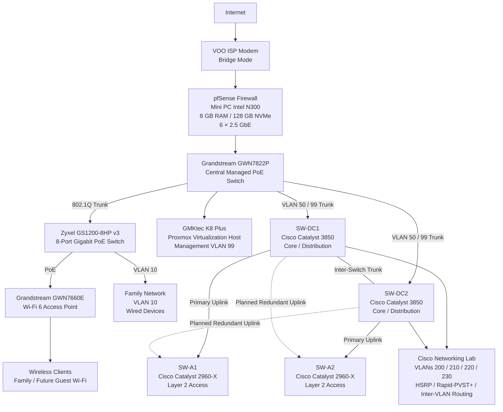

# 🏠 Homelab Infrastructure Project

This repository documents the design, deployment, operation, and evolution of my personal IT homelab.

The project was created to move beyond simulated environments such as Cisco Packet Tracer and GNS3 and apply the networking knowledge acquired through my CompTIA Network+ and Cisco CCNA studies to real enterprise hardware.

The environment is built around Cisco switching, Grandstream, Zyxel, pfSense, Proxmox, Windows Server, Active Directory, and Linux.

The core physical and network infrastructure is now operational, including the Cisco networking laboratory. Advanced networking, virtualization, systems administration, and security laboratories continue to evolve.

Its purpose is not only to build a working infrastructure, but to document the complete engineering process:

**design → deployment → verification → troubleshooting → improvement**

The homelab also serves as a practical platform for my Security+ preparation and future CCNP studies.

---

## 🚧 Current status

**Core Infrastructure and Cisco Lab Deployed – Redundancy Completion and Lab Expansion in Progress**

The core homelab infrastructure and the Cisco networking laboratory are deployed and operational.

Internet connectivity, routing, firewalling, VLAN segmentation, wired and wireless access, and the Proxmox virtualization host are established.

The Cisco laboratory uses two Catalyst 3850 switches in a collapsed-core/distribution architecture and two Catalyst 2960-X access switches.

HSRP, Rapid-PVST+, inter-VLAN routing, and dedicated management connectivity have been configured on the Cisco infrastructure.

The remaining access-layer cross-uplinks are not yet physically connected. Full access-layer redundancy and associated failover tests will be completed once the additional Ethernet cables are installed.

The project is now focused on advanced networking, virtualization, systems administration, security laboratories, and continuous infrastructure improvement.

### ✅ Completed

- ✅ [First Cisco Catalyst 2960-X acquired and validated](Materials/Cisco-Switchs/Cisco-2960x-1/README.md)
- ✅ [Second Cisco Catalyst 2960-X acquired and validated](Materials/Cisco-Switchs/Cisco-2960x-2/README.md)
- ✅ [First Cisco Catalyst 3850 acquired and validated](Materials/Cisco-Switchs/Cisco-3850-1/README.md)
- ✅ [Second Cisco Catalyst 3850 acquired and validated](Materials/Cisco-Switchs/Cisco-3850-2/README.md)
- ✅ [Grandstream GWN7822P deployed](Materials/Grandstream/README.md)
- ✅ [Grandstream GWN7660E Wi-Fi 6 access point deployed](Materials/Grandstream%20AP/README.md)
- ✅ [Zyxel GS1200-8HP v3 deployed](Materials/Zyxel/README.md)
- ✅ [pfSense firewall/router deployed](Materials/Mini-PC%20Pfsense/README.md)
- ✅ [GMKtec K8 Plus Proxmox host deployed](Materials/Mini-PC%20Proxmox/README.md)
- ✅ [15U Lanberg rack installed](Materials/Rack/README.md)
- ✅ [Atlantis A03-HP2003 UPS installed](Materials/UPS/README.md)
- ✅ VOO GigaMax modem configured in bridge mode
- ✅ pfSense configured as the main router and firewall
- ✅ NAT and internet connectivity operational
- ✅ VLAN-based network segmentation implemented
- ✅ Family Network (VLAN 10) operational
- ✅ Management Network (VLAN 99) configured
- ✅ Grandstream and Zyxel switch connectivity established
- ✅ Wi-Fi 6 connectivity operational
- ✅ PoE connectivity established for the wireless access point
- ✅ Inter-VLAN routing and firewall policies implemented
- ✅ Proxmox host installed and management access configured
- ✅ Cisco collapsed-core topology deployed with SW-DC1 and SW-DC2
- ✅ Cisco access switches SW-A1 and SW-A2 deployed with their primary uplinks
- ✅ Cisco management connectivity established through VLAN 99
- ✅ Cisco transit connectivity established through VLAN 50
- ✅ HSRP configured for Cisco laboratory VLANs 200, 210, 220, and 230
- ✅ Rapid-PVST+ configured and aligned with HSRP gateway priorities
- ✅ SSH management configured on Cisco distribution switches

### 🔄 In progress

- 🔄 Complete the SW-A1 ↔ SW-DC2 and SW-A2 ↔ SW-DC1 redundant uplinks
- 🔄 Validate access-layer redundancy and failover
- 🔄 Advanced Layer 2 and Layer 3 networking laboratories
- 🔄 Proxmox virtual networking and virtual machine deployment
- 🔄 Firewall policy refinement and network security hardening
- 🔄 Repository structure and technical documentation
- 🔄 Network diagrams and configuration documentation
- 🔄 Final cable management and rack optimization
- 🔄 Homelab architecture improvements

### 📋 Planned

- 📋 Windows Server and Active Directory documentation
- 📋 Group Policy (GPO) laboratories
- 📋 Linux server administration laboratories
- 📋 Advanced dynamic routing laboratories, including OSPF
- 📋 Extended HSRP and spanning-tree failover testing
- 📋 EtherChannel laboratories
- 📋 Dedicated guest wireless network
- 📋 Centralized network monitoring and logging
- 📋 Backup and recovery strategy
- 📋 Advanced network security and traffic analysis laboratories

---

## 🎯 Objectives

The main objectives of this homelab are to:

- Apply CCNA networking knowledge on physical enterprise hardware
- Design and operate a segmented multi-VLAN network
- Practice Layer 2 and Layer 3 networking
- Implement and understand inter-VLAN routing
- Deploy and manage routing, firewalling, and NAT with pfSense
- Practice structured network troubleshooting
- Deploy Windows Server, Active Directory, and Linux services
- Learn and practice virtualization with Proxmox
- Build a secure remote administration environment
- Apply network security features on real equipment
- Document configurations, failures, troubleshooting, and solutions
- Support future CCNP and ongoing Security+ studies

---

## 🗺️ Current architecture

The main home network infrastructure and the Cisco networking laboratory are deployed and operational.

The Cisco laboratory follows a collapsed-core architecture, with two Catalyst 3850 switches providing distribution and Layer 3 services and two Catalyst 2960-X switches operating at the access layer.

The diagram below represents the deployed infrastructure and distinguishes operational connections from planned redundant links.



**Diagram legend:**

- **Solid lines:** Deployed physical or logical network connections.
- **Dashed lines:** Planned redundant links not yet physically connected.

> **Current cabling limitation:** The redundant uplinks between SW-A1 and SW-DC2, and between SW-A2 and SW-DC1, are not yet connected due to a temporary shortage of Ethernet cables.
>
> These connections will be added in a future topology update. Until then, spanning-tree root and port-state observations reflect the current physical topology, and complete access-layer failover cannot yet be validated.

### Component roles

| Component | Role |
|---|---|
| **VOO ISP Modem** | Provides internet connectivity in bridge mode, allowing pfSense to operate as the main firewall and router |
| **pfSense Mini PC** | Main firewall, NAT, VLAN gateways, routing, and network security policies |
| **Grandstream GWN7822P** | Central managed switch connecting the family network, management infrastructure, Proxmox host, and Cisco laboratory |
| **Grandstream GWN7660E** | Wi-Fi 6 access point providing wireless connectivity for family devices (VLAN 10), powered via PoE |
| **Zyxel GS1200-8HP v3** | Managed Gigabit PoE switch extending the family network and connecting to the Grandstream switch through an 802.1Q trunk |
| **SW-DC1 — Catalyst 3850** | Core / Distribution switch, providing Layer 3 routing and preferred HSRP Active gateway for VLANs 200 and 210 |
| **SW-DC2 — Catalyst 3850** | Core / Distribution switch, providing Layer 3 routing and preferred HSRP Active gateway for VLANs 220 and 230 |
| **SW-A1 — Catalyst 2960-X** | Layer 2 access switch connected to SW-DC1, with a future redundant uplink to SW-DC2 |
| **SW-A2 — Catalyst 2960-X** | Layer 2 access switch connected to SW-DC2, with a future redundant uplink to SW-DC1 |
| **Proxmox Server** | Operational virtualization host used for Windows Server, Linux, security, and infrastructure laboratories |

> The core infrastructure and Cisco laboratory are operational. The architecture continues to evolve as redundant connections, additional virtual machines, network services, and advanced laboratories are integrated.

---

## 🌐 Network segmentation

The network uses VLAN-based segmentation to separate family devices, management traffic, virtualization services, and laboratory environments.

### VLAN design

| VLAN | Purpose | Status |
|---|---|---|
| VLAN 10 | Family network | Operational |
| VLAN 50 | Cisco / Homelab transit network | Operational |
| VLAN 99 | Management network | Operational |
| VLAN 100 | Virtualization / server network | Operational |
| VLAN 110 | Virtualization / laboratory network | Reserved for expansion |
| VLAN 120 | Virtualization / laboratory network | Reserved for expansion |
| VLAN 130 | Virtualization / laboratory network | Reserved for expansion |
| VLAN 140 | Virtualization / laboratory network | Reserved for expansion |
| VLAN 150 | Virtualization / laboratory network | Reserved for expansion |
| VLAN 200 | Cisco laboratory network | Configured with HSRP |
| VLAN 210 | Cisco laboratory network | Configured with HSRP |
| VLAN 220 | Cisco laboratory network | Configured with HSRP |
| VLAN 230 | Cisco laboratory network | Configured with HSRP |
| VLAN 250 | Future laboratory network | Planned |
| VLAN 999 | Blackhole / unused ports | Planned security practice |

The network architecture separates routing responsibilities between pfSense and the Cisco laboratory.

**pfSense** provides firewalling, NAT, routing, and security policy enforcement for the main homelab infrastructure.

**Cisco Catalyst 3850 switches** provide Layer 3 routing within the Cisco laboratory, including HSRP first-hop redundancy.

VLAN 50 provides transit connectivity between the Cisco distribution layer and the upstream network infrastructure.

VLAN 99 provides dedicated management connectivity for authorized administrative access to network equipment.

Grandstream and Zyxel operate primarily as managed Layer 2 switches within the main home network.

### Segmentation objectives

The main goal is to isolate the laboratory environment from the family network while allowing controlled internet access and authorized management traffic.

The segmentation also allows me to:

- Separate family devices from experimental networking environments
- Restrict administrative access to network equipment
- Apply dedicated firewall rules between VLANs
- Test network security policies
- Build additional isolated virtual and physical networks
- Experiment with routing without disrupting the family network
- Practice network troubleshooting across different routing domains

---

## 🖥️ Hardware

Each major device has its own documentation folder under `Materials/`.

The status below reflects the deployed infrastructure.

| Status | Device | Role |
|---|---|---|
| ✅ Deployed | Cisco Catalyst WS-C2960X-24TS-L — SW-A1 | Layer 2 access switch |
| ✅ Deployed | Cisco Catalyst WS-C2960X-24TS-L — SW-A2 | Layer 2 access switch |
| ✅ Deployed | Cisco Catalyst 3850 — SW-DC1 | Layer 3 distribution / collapsed-core |
| ✅ Deployed | Cisco Catalyst 3850 — SW-DC2 | Layer 3 distribution / collapsed-core |
| ✅ Deployed | Grandstream GWN7822P | Central VLAN switching |
| ✅ Deployed | Mini PC — pfSense | Firewall / router |
| ✅ Deployed | Mini PC — Proxmox | Virtualization host |
| ✅ Installed | 15U Lanberg rack | Physical infrastructure |
| ✅ Installed | Atlantis A03-HP2003 | UPS / Power Protection |
| ✅ Deployed | Grandstream GWN7660E | Wi-Fi 6 Access Point |
| ✅ Deployed | Zyxel GS1200-8HP v3 | Family Network / PoE Switch |

Smaller accessories such as console cables, patch cables, keystone modules, and patch-panel components are documented separately under `Materials/Accessory/`.

---

## 🧱 Cisco lab

**Status: Core and access-layer infrastructure deployed and operational.**

The Cisco laboratory provides a physical environment for practicing and extending networking concepts studied through CCNA and future CCNP work.

The laboratory consists of four physical Cisco Catalyst switches:

- **2 × Cisco Catalyst 3850** — Core / Distribution layer
- **2 × Cisco Catalyst 2960-X** — Access layer

The two Catalyst 3850 switches operate in a collapsed-core architecture and provide Layer 3 routing, gateway redundancy, and distribution connectivity.

The two Catalyst 2960-X switches provide Layer 2 access connectivity, VLAN segmentation, trunking, and spanning-tree integration.

### Current implementation

The laboratory currently includes:

- Collapsed-core architecture using SW-DC1 and SW-DC2
- Two deployed access switches: SW-A1 and SW-A2
- 802.1Q trunk connections between network devices
- Dedicated management connectivity through VLAN 99
- Transit connectivity through VLAN 50
- Inter-VLAN routing on the Catalyst 3850 switches
- HSRP gateway redundancy for VLANs 200, 210, 220, and 230
- HSRP priority distribution between SW-DC1 and SW-DC2
- Rapid-PVST+ configuration aligned with the HSRP design
- SSH-based management of the distribution switches

### HSRP distribution

| VLAN | Preferred HSRP Active | Preferred HSRP Standby |
|---|---|---|
| VLAN 200 | SW-DC1 | SW-DC2 |
| VLAN 210 | SW-DC1 | SW-DC2 |
| VLAN 220 | SW-DC2 | SW-DC1 |
| VLAN 230 | SW-DC2 | SW-DC1 |

This design distributes the preferred active gateway roles between both distribution switches.

Spanning-tree priorities are aligned with the HSRP design to support consistent Layer 2 forwarding paths.

### Current physical topology limitation

The primary access-layer connections are deployed:

- SW-A1 ↔ SW-DC1
- SW-A2 ↔ SW-DC2

The following redundant connections are planned:

- SW-A1 ↔ SW-DC2
- SW-A2 ↔ SW-DC1

These secondary uplinks are not yet physically connected due to a temporary shortage of Ethernet cables.

As a result, current spanning-tree observations reflect the existing physical topology rather than the intended fully redundant access-layer design.

Once the additional cables are installed, spanning-tree behavior and access-layer failover will be tested and documented.

### Cisco Switch Configurations

The following documentation includes network diagrams, VLAN assignments, routing configurations, security hardening, CLI verification screenshots, and sanitized configuration files.

- **[SW-DC1 — Cisco Catalyst 3850 Configuration](Configs/Cisco/SW-DC1/README.md)** — Core / Distribution switch, preferred HSRP Active for VLANs 200 and 210.
- **[SW-DC2 — Cisco Catalyst 3850 Configuration](Configs/Cisco/SW-DC2/README.md)** — Core / Distribution switch, preferred HSRP Active for VLANs 220 and 230.
- **[SW-A1 — Cisco Catalyst 2960-X Configuration](Configs/Cisco/SW-A1/README.md)** — Layer 2 access switch, connected to SW-DC1, with VLAN segmentation, trunking, and Rapid-PVST+.
- **[SW-A2 — Cisco Catalyst 2960-X Configuration](Configs/Cisco/SW-A2/README.md)** — Layer 2 access switch, connected to SW-DC2, with VLAN segmentation, trunking, and Rapid-PVST+.

### Main areas

- Layer 2 switching: VLANs, trunking, STP/RPVST+, EtherChannel
- Layer 2 security: Port Security, DHCP Snooping, DAI, BPDU Guard
- Layer 3 networking: inter-VLAN routing, static and dynamic routing, IPv4/IPv6
- First-hop redundancy: HSRP for IPv4 and HSRP for IPv6
- Network architecture: access/distribution roles and collapsed-core design
- Management and hardening: SSH, management VLANs, device security
- Troubleshooting, validation, redundancy, and failover testing

The Cisco laboratory operates alongside the existing pfSense-based infrastructure while allowing additional routing and switching scenarios to be tested.

The long-term objective is to reuse the same physical infrastructure for more advanced CCNP-oriented laboratories.

---

## 🖥️ Virtualization and systems lab

The virtualization and systems lab is designed to deploy, integrate, and troubleshoot Windows and Linux environments.

The GMKtec K8 Plus Proxmox host is installed and operational.

The virtualization platform provides the foundation for deploying additional virtual machines, isolated virtual networks, and infrastructure services.

### Main areas

- Proxmox virtualization and virtual networking
- Windows Server and Active Directory
- Windows client integration and Group Policy
- Linux server administration
- DNS, DHCP, file services, and authentication
- Logging, monitoring, backups, and security
- Integration with the physical VLAN infrastructure
- Structured systems troubleshooting

### Current focus

The next steps involve expanding the Proxmox environment, deploying and documenting Windows Server and Active Directory services, adding Linux virtual machines, and testing connectivity with the Cisco laboratory through controlled routing and firewall policies.

The objective is to connect physical networking concepts with virtualized systems administration and security laboratories.

---

## 📚 Documentation approach

Documentation is intentionally separated into two areas.

### `Materials/`

The `Materials/` directory acts as the equipment identity card.

Each device folder may contain:

- Why the equipment was selected
- Acquisition information
- Physical condition
- Initial inspection
- Software version
- Hardware verification
- Photos
- Current status

Example:

```text
Materials/
└── Cisco-Switchs/
    └── Cisco-2960x-1/
        ├── README.md
        └── Pictures/
```

### `Labs/`

The lab folders document what is actually built with the equipment.

Each lab follows a consistent structure:

1. **Objective**
2. **Topology**
3. **Configuration**
4. **Verification**
5. **Troubleshooting**
6. **Solution**
7. **Lessons learned**

Failed attempts are documented alongside successful implementations.

The goal is to show the real engineering process rather than only the final working configuration.

---

## 🔐 Security principles

### Infrastructure

The homelab is designed and operated with security in mind.

The core infrastructure already uses VLAN segmentation, pfSense firewall policies, and dedicated network management.

Current and planned security practices include:

- SSH-based administration
- Avoiding Telnet for device administration
- Dedicated management VLAN
- Local authentication
- Firewall policies
- Network segmentation
- DHCP Snooping
- Dynamic ARP Inspection
- Port Security
- BPDU Guard
- Secure device credentials
- Centralized logging
- Monitoring
- Controlled inter-VLAN communication
- Restricted management access
- Separation between family and lab networks

Some of these security features are already part of the operational infrastructure, while others will be implemented and tested in the Cisco and security laboratories.

### Repository

Sensitive information is never intentionally committed.

Repository rules include:

- No passwords
- No private keys
- No real public IP addresses
- No API tokens
- No sensitive credentials
- No unsanitized configuration backups
- Configuration files sanitized before publication
- Secrets checked before commits

---

## 📂 Repository structure

```text
Homelab/
│
├── README.md
├── CHANGELOG.md
├── .gitignore
│
├── Materials/
│   ├── Cisco-Switchs/
│   │   ├── Cisco-2960x-1/
│   │   ├── Cisco-2960x-2/
│   │   ├── Cisco-3850-1/
│   │   └── Cisco-3850-2/
│   ├── Grandstream/
│   ├── Grandstream AP/
│   ├── Zyxel/
│   ├── Mini-PC Pfsense/
│   ├── Mini-PC Proxmox/
│   ├── Rack/
│   ├── UPS/
│
├── Labs/
│   ├── Cisco/
│   └── Virtualization/
│
├── Configs/
│   ├── Cisco/
│   │   ├── SW-DC1/
│   │   │   └── README.md
│   │   ├── SW-DC2/
│   │   │   └── README.md
│   │   ├── SW-A1/
│   │   │   └── README.md
│   │   └── SW-A2/
│   │       └── README.md
│   ├── pfSense/
│   └── Grandstream/
│
└── Troubleshooting/
```

> The repository structure evolves as new equipment, configurations, and laboratories are documented.

---

## 🛠️ Phase 1 — Network infrastructure

The core network infrastructure and Cisco laboratory have been deployed successfully.

- [x] First Cisco Catalyst 2960-X acquired and validated
- [x] Second Cisco Catalyst 2960-X acquired and validated
- [x] First Cisco Catalyst 3850 acquired and validated
- [x] Second Cisco Catalyst 3850 acquired and validated
- [x] Grandstream GWN7822P switch deployed
- [x] Zyxel GS1200-8HP v3 deployed
- [x] Grandstream GWN7660E Wi-Fi 6 AP deployed
- [x] pfSense mini PC deployed
- [x] VOO GigaMax modem configured in bridge mode
- [x] 15U rack installed
- [x] Atlantis A03-HP2003 UPS installed
- [x] Core network architecture deployed
- [x] VLAN segmentation implemented
- [x] Family VLAN 10 operational
- [x] Management VLAN 99 configured
- [x] Inter-VLAN routing and firewall policies deployed
- [x] Wi-Fi 6 family network operational
- [x] PoE connectivity for wireless access point established
- [x] Cisco collapsed-core architecture deployed
- [x] Cisco access switches deployed with primary uplinks
- [x] Cisco transit VLAN 50 configured
- [x] Cisco management VLAN 99 configured
- [x] HSRP configured for VLANs 200, 210, 220, and 230
- [x] Rapid-PVST+ configured and aligned with HSRP
- [ ] Complete the redundant access-layer uplinks
- [ ] Validate access-layer redundancy and failover
- [ ] Final rack and cable management completed

---

## 🖥️ Phase 2 — Virtualization and systems

The Proxmox virtualization host is operational, and the next phase focuses on deploying and documenting virtualized infrastructure services.

- [x] Proxmox host acquired
- [x] Proxmox virtualization platform installed and accessible
- [x] Proxmox management network configured
- [ ] Windows Server and Active Directory deployment documented
- [ ] Group Policy (GPO) laboratories documented
- [ ] Linux server environment deployed and documented
- [ ] Virtualization lab fully integrated with the physical network
- [ ] Monitoring and centralized logging implemented
- [ ] Backup strategy implemented

---

## 🔐 Phase 3 — Advanced networking and security

The operational core infrastructure and Cisco laboratory provide a foundation for more advanced networking and security experiments.

Future areas include:

- Advanced routing, redundancy, and high availability
- VPN, AAA, and centralized authentication
- Network monitoring, Syslog, and SNMP
- Network hardening and advanced firewall policies
- Network traffic analysis and security monitoring
- Automation, CCNP-oriented labs, and Security+-oriented labs

---

## 🧪 Troubleshooting philosophy

Troubleshooting is treated as an important part of the project.

Problems are documented whenever possible with:

- Symptoms
- Initial assumptions
- Verification commands
- Root cause
- Corrective action
- Final validation
- Lessons learned

The goal is not to hide failures, but to use them as part of the learning process.

The deployment of the core infrastructure and Cisco laboratory has already provided practical troubleshooting experience involving:

- Network connectivity and VLAN configuration
- 802.1Q trunking
- Management VLAN connectivity
- Cisco transit routing
- SSH management and algorithm compatibility
- HSRP gateway configuration
- Spanning-tree topology and root bridge placement
- Firewall policies and routing
- Virtualization networking

These experiences are part of the documentation process and help reinforce the theoretical knowledge acquired during my studies.

---

## 🚀 Project philosophy

This homelab is a long-term learning environment.

The core infrastructure and Cisco networking laboratory are operational, but the project continues to evolve through new laboratories, configurations, and technical challenges.

The objective is not to build everything at once, but to progressively design, deploy, test, break, troubleshoot, improve, and document the infrastructure.

The repository is therefore intended to show not only the final architecture, but also the decisions, mistakes, troubleshooting process, and lessons learned during the project.

**Core infrastructure and Cisco laboratory operational — redundancy completion, advanced laboratories, and documentation continuously evolving.**
