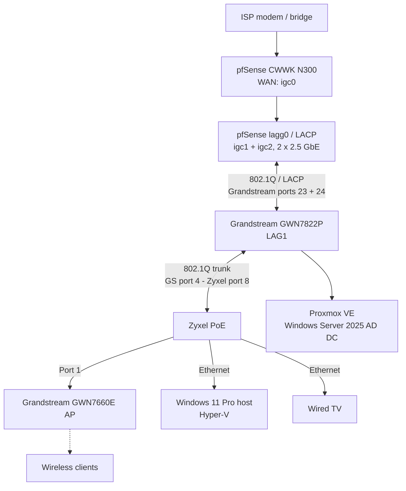

# Network Instability After Hyper-V / VLAN Changes — Incident Report

**Homelab troubleshooting case study**  
**Incident began:** 8 November 2026  
**Status:** Monitoring after Grandstream firmware update; root cause **not confirmed**  
**Affected areas:** Hyper-V VM connectivity, management access, wired and wireless clients, pfSense–Grandstream LACP uplink

> **Scope and evidence:** This report separates what I observed, what the logs confirmed, and what remains a hypothesis. Connectivity returning does **not** prove that the underlying root cause has been fixed.

## 1. Objective

Deploy a Windows 11 Enterprise client VM using Hyper-V on my Windows 11 Pro desktop, and connect it to an Active Directory domain controller (Windows Server 2025) running under Proxmox VE in VLAN 100. The plan was to practice domain joins, administration and Group Policy.

## 2. Relevant topology



**VLANs involved**

| VLAN | Purpose | Subnet / gateway |
|---|---|---|
| 10 | FAMILY | `192.168.10.0/24` / `192.168.10.1` |
| 99 | MGMT | `192.168.99.0/24` / `192.168.99.1` |
| 100 | VIRTUALIZATION LAB | `192.168.100.0/24` / `192.168.100.1` |
| 50 | Cisco lab transit | `192.168.50.0/24` / `192.168.50.1` |

**LACP physical member mapping, verified against matching log timestamps:**

| pfSense | Grandstream | Role |
|---|---|---|
| `igc1` | Ethernet `1/0/24` | LAG member |
| `igc2` | Ethernet `1/0/23` | LAG member that repeatedly flapped |

## 3. Changes and symptoms — chronological account

### Baseline: working

- Desktop Wi-Fi: VLAN 10 (FAMILY).
- Desktop Ethernet: VLAN 99 (MGMT), `192.168.99.50`.
- Home network services and device connectivity were operating normally.

### Change 1: try Hyper-V over Wi-Fi in VLAN 100

- Created an SSID mapped to **VLAN 100**; Wi-Fi host used `192.168.100.50`.
- Kept desktop Ethernet in **VLAN 99**, `192.168.99.50`.
- Allowed VLAN 100 on Zyxel **port 1** (AP uplink), **port 8** (Grandstream trunk), and Grandstream **port 4** (Zyxel trunk).
- Created a Hyper-V **External Virtual Switch** and installed a Windows 11 Enterprise VM.

**Observed:** The VM could reach local devices, including the Proxmox-hosted domain controller and the host/laptop, but **could not access the Internet** to run Windows Update. Local reachability alone did not establish whether DNS, default gateway, NAT or outbound traffic were working correctly.

**Firewall check:** I reviewed pfSense rules for VLAN 100 and outbound connectivity. The required traffic **appeared permitted**; I did not identify an obvious blocking rule. This does **not** rule out gateway, NAT, DNS or other path issues.

### Change 2: move Hyper-V to wired Ethernet

Having considered the limitations of Hyper-V external switches on Wi-Fi:

- Removed the first external vSwitch.
- Changed Wi-Fi to **VLAN 99**, host IP `192.168.99.50`.
- Changed Ethernet to **VLAN 100**, host IP `192.168.100.50`.
- Remapped the SSID to VLAN 99.
- Removed VLAN 100 from Zyxel **port 1** (AP), but kept VLAN 100 on the Zyxel–Grandstream trunk.
- Recreated the Hyper-V External Virtual Switch on the **Ethernet** adapter.

**Symptoms that followed:**

- Wired TV on Zyxel lost Internet; the same TV could still work over Wi-Fi.
- Other Wi-Fi clients (phone and laptop) still had Internet on FAMILY VLAN 10.
- Desktop Wi-Fi lost Internet.
- Management access to pfSense became unreliable after restoring the original settings.
- Grandstream `192.168.99.2` could reach the desktop `192.168.99.50`, but could not consistently ping pfSense `192.168.99.1`.
- Hyper-V client networking also remained problematic.

This was **not** a uniform outage across all clients and VLANs.

### Initial investigation and temporary recovery

I checked trunk memberships, tagged/untagged VLAN configuration, firewall rules, MAC/ARP tables and ICMP connectivity. I attempted ARP-table and switch MAC-table cleanup, and rebooted the ISP box and the Grandstream at some point during troubleshooting.

When I started a **pfSense Packet Capture** on the MGMT interface and repeated the Grandstream → `192.168.99.1` ping, ICMP packets appeared and the ping succeeded. Shortly afterward, desktop Wi-Fi and wired TV access also returned.

**Important:** Packet Capture and recovery coincided. There is **no evidence that starting the capture fixed the issue**.

## 4. Evidence: logs from both ends of the LACP uplink

### Grandstream: physical port flapping

Selected messages from `show logging` on **8 November 2026**:

```text
17:26:33  SYSTEM-4-REBOOT: System reboot by -[CLI]set reboot-
17:36:32  PORT-5-LINK_DOWN: Interface LAG1 link down
17:36:32  PORT-5-LINK_DOWN: Interface Ethernet1/0/24 link down
17:36:32  PORT-5-LINK_DOWN: Interface Ethernet1/0/23 link down
17:36:37  PORT-5-LINK_UP:   Interface Ethernet1/0/23 link up
17:36:37  PORT-5-LINK_UP:   Interface Ethernet1/0/24 link up
17:36:40  PORT-5-LINK_UP:   Interface LAG1 link up
17:53:33  PORT-5-LINK_DOWN: Interface Ethernet1/0/23 link down
17:53:37  PORT-5-LINK_UP:   Interface Ethernet1/0/23 link up
17:53:38  PORT-5-LINK_DOWN: Interface Ethernet1/0/23 link down
17:53:41  PORT-5-LINK_UP:   Interface Ethernet1/0/23 link up
17:56:41  PORT-5-LINK_DOWN: Interface Ethernet1/0/23 link down
17:56:45  PORT-5-LINK_UP:   Interface Ethernet1/0/23 link up
17:58:01  PORT-5-LINK_DOWN: Interface Ethernet1/0/23 link down
17:58:05  PORT-5-LINK_UP:   Interface Ethernet1/0/23 link up
```

The 17:26 reboot was explicitly initiated through CLI. It should not be confused with the later repeated link changes.

### pfSense: same link changes, same timestamps

```text
17:53:34  igc2: link state changed to DOWN
17:53:37  igc2: link state changed to UP
17:53:38  igc2: link state changed to DOWN
17:53:42  igc2: link state changed to UP
17:56:41  igc2: link state changed to DOWN
17:56:45  igc2: link state changed to UP
17:58:01  igc2: link state changed to DOWN
17:58:05  igc2: link state changed to UP
```

Both systems recorded corresponding transitions on **Grandstream port 23 ↔ pfSense `igc2`**. This supports a real link-state instability, not merely an ICMP or firewall policy issue. Slight one-second differences are normal for separate logging systems and do not identify which side caused the change.

At **17:36**, both LAG members went down and LAG1 dropped, potentially interrupting access to multiple VLAN gateways on pfSense.

### Overnight recurrence

After the initial incident, link flapping was observed again **overnight, for approximately two hours while I was asleep**, with no deliberate network configuration changes during that period. This is significant: the recurrent link problem cannot be attributed solely to active Hyper-V/VLAN edits. The exact overnight timestamps and individual messages should be added to this README when exported.

## 5. Additional observations

### LACP and interface health at inspection time

From `ifconfig -a` on pfSense:

```text
lagg0: status: active
laggproto lacp lagghash l2,l3,l4
laggport: igc1 flags=1c<ACTIVE,COLLECTING,DISTRIBUTING>
laggport: igc2 flags=1c<ACTIVE,COLLECTING,DISTRIBUTING>
```

Grandstream LACP counters indicated exchanges on both members without reported LACP packet errors. Interface snapshots showed no CRC/input/output errors. **These are current-state observations; they do not negate historical link flapping.**

### ARP behavior

pfSense repeatedly logged a changing IP-to-MAC association for `192.168.10.103` on VLAN 10:

```text
arp: 192.168.10.103 moved from ec:74:d7:da:1e:7e to c8:91:43:5a:17:96 on lagg0.10
arp: 192.168.10.103 moved from c8:91:43:5a:17:96 to ec:74:d7:da:1e:7e on lagg0.10
```

This **may** suggest an IP conflict or another device/addressing behavior; it does not, on its own, prove a switch MAC-flapping loop or broadcast storm.

During subsequent troubleshooting, ARP reachability between pfSense and Grandstream also appeared asymmetric until communication was initiated from the other direction. The cause was not established.

### DNS Resolver and interface/service reloads

During link/interface disruptions, pfSense recorded Unbound startup errors:

```text
unbound: error: bind: address already in use
unbound: fatal error: could not open ports
```

There were also firewall reloads, interface handling events and gateway-monitoring messages. These may be **downstream effects** of interface changes/restarts rather than separate root causes.

### Legacy VLAN configuration

Inspection showed old `igc1.10`, `igc1.50`, `igc1.99`, and `igc1.100` VLAN definitions coexisting with active VLANs on `lagg0`. Since `igc1` is a LAG member, active VLANs belong on `lagg0`. The legacy definitions were cleaned up after checking interface assignments. This cleanup is **not proven** to explain the flapping.

### WAN events

The logs also show `igc0` WAN link changes and reconnection behavior around 17:38–17:43, consistent with a possible ISP-box restart. Their exact relationship to the LAG1 issue has not been demonstrated.

## 6. Working hypotheses (not confirmed root causes)

| Hypothesis | Evidence for / against | Status |
|---|---|---|
| Hyper-V external vSwitch or guest networking misconfiguration | Initial LAN worked but Internet did not; changes preceded client issues | Plausible for **VM Internet** issue, not sufficient to explain physical `igc2` link changes |
| VLAN/SSID/trunk configuration transitions | Many changes immediately preceded client disruptions | Plausible contributor; no single faulty setting confirmed |
| Intermittent cable/connector or PHY negotiation problem | Repeated DOWN/UP events recorded at both ends of one 2.5 GbE link | Needs controlled physical test |
| Intel `igc` driver, NIC NVM/firmware, EEE or power-management interaction | pfSense uses 2.5 GbE Intel-family `igc` interfaces; recurring issue occurred without user intervention | Requires exact hardware/driver/firmware identification and evidence |
| Grandstream firmware or port behavior | Port 23 repeatedly flapped; firmware update now applied | Monitor recurrence before drawing conclusions |
| LACP behavior during member transitions | Whole bundle went down at least once, other times individual member flapped | Could amplify interruptions; not necessarily original trigger |
| Layer-2 loop / broadcast storm | Would be compatible with some widespread connectivity symptoms | **No direct evidence** from logs or counters; does not normally explain physical link-down events |

**Interpretation:** There may have been several overlapping faults. There is not yet enough evidence to collapse everything into one root cause—or to conclude that each logged error is an independent problem.

## 7. Actions taken and current status

| Action | Status |
|---|---|
| Checked VLAN/trunk membership and pfSense firewall rules | Done |
| Tested VM-to-LAN and management ICMP connectivity | Done |
| Reviewed ARP and switch MAC tables | Done |
| Captured ICMP on pfSense MGMT interface | Done |
| Correlated Grandstream and pfSense link logs | Done |
| Inspected LACP state and interface error counters | Done |
| Cleaned up legacy VLAN entries on `igc1` | Done |
| **Updated Grandstream GWN7822P firmware** | **Done** — exact installed version not included here |
| **Monitor for further flapping after update** | **In progress** |
| Replace/test `igc2` ↔ Grandstream port 23 cable | Not yet done |
| Test another port or controlled single-link / speed configuration | Not yet done |
| Investigate precise Intel NIC model, driver and NVM/firmware | Research discussed; no driver/NVM change confirmed |

**Do not assume the firmware update fixed the issue:** an absence of new events over a short interval is encouraging but not proof of causality.

## 8. Next troubleshooting steps

1. Preserve switch/pfSense logs and save running configurations before testing.
2. Monitor the specific `igc2` and Ethernet `1/0/23` link-event counters and timestamps after the Grandstream update.
3. If flapping returns, replace only the cable on that member, keeping all other variables unchanged; compare results.
4. If needed, move to another compatible Grandstream port in a controlled maintenance window and monitor again.
5. Identify the exact Intel controller, `igc` driver and NVM versions; consult vendor-supported updates and release notes before making changes.
6. Only if needed, test a single stable link or a negotiated 1 GbE rate under controlled conditions with a management recovery path available.
7. Separately return to the **Windows 11 VM Internet** issue (guest address, route, DNS, NAT, filtering and vSwitch/host-adapter configuration), avoiding unrelated infrastructure changes.

Avoid changing cables, firmware, LACP, port speed and VLAN rules simultaneously: otherwise the effect of each change cannot be isolated.

## 9. Commands and tools used

**Grandstream CLI (read-only checks):**

```text
show logging
show lag
show lacp neighbor
show lacp counters
show interfaces Ethernet 1/0/23
show interfaces Ethernet 1/0/24
show interfaces Ethernet 1/0/4
show storm-control
show arp
```

**pfSense:**

```sh
ifconfig -a
```

GUI: **Diagnostics → Packet Capture** (MGMT, ICMP), **Status → System Logs**, **Interfaces → Assignments → VLANs**.

**Windows/network tests:** `ping`, `arp -a`, `arp -d`; switch MAC table inspection/cleanup during initial troubleshooting.

## 10. Lessons learned

- **LAN reachability is not equivalent to Internet reachability.** Test L2, addressing, default route, DNS, firewall and NAT separately.
- Correlating **logs from both ends of a link** is more persuasive than relying on a single ping or dashboard.
- A physically flapping link can show **zero CRC errors** when checked later.
- A LAG may be healthy when inspected but have been unstable earlier.
- A DNS error or ARP change may be a **secondary symptom**, not the triggering event.
- Restored service does not establish root cause. Preserve evidence and change **one variable at a time**.

---

**Incident conclusion (provisional):** The network suffered confirmed pfSense–Grandstream link-state instability, including overnight recurrence without active intervention. A Grandstream firmware update has been performed, and monitoring is ongoing. The original Hyper-V guest Internet issue remains a separate unresolved question, and the **root cause of the link flapping is not yet known**.
