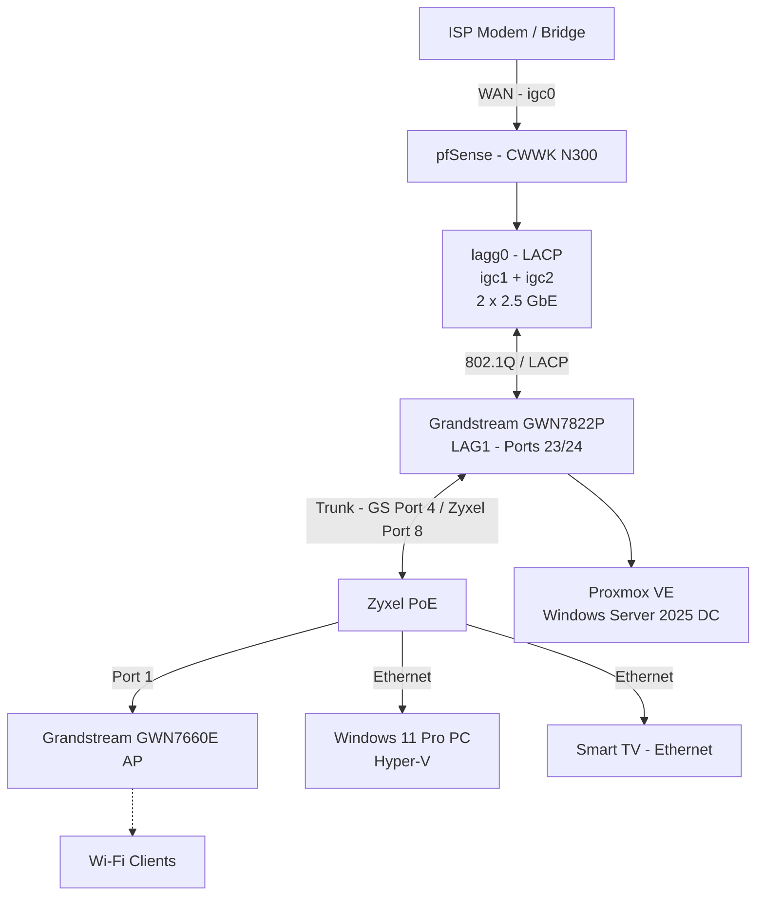

# Network Troubleshooting — Hyper-V, VLANs & LACP Link Flapping

**Date:** November 8–9, 2026  
**Environment:** My personal homelab  
**Status:** Monitoring after Grandstream firmware update  
**Root cause:** Still under investigation

## Introduction

What started as a simple Windows 11 VM deployment turned into a much bigger networking troubleshooting session than I expected! 😅

My initial goal was to install a Windows 11 Enterprise VM using Hyper-V and connect it to my Active Directory domain controller running on Proxmox.

I wanted to practice domain joins, Group Policy (GPO), and Windows administration in a simulated enterprise environment.

Instead, I ended up dealing with VLAN changes, unexpected connectivity issues, ARP behavior, LACP, and repeated Ethernet link flapping between my Grandstream switch and pfSense.

I also learned quite a lot about reading network logs.

I'm still a beginner when it comes to log analysis, so I used AI to help me understand the messages, compare events from different devices, and decide what to investigate next.

**This README documents what happened, what I tested, what I discovered, and what I still need to figure out.**

The network is currently working, but I haven't confirmed the root cause of the link flapping yet.

---

## 1. My Network Setup

The main devices involved in this incident are:

| Device | Model / Platform | Role |
|---|---|---|
| Firewall | pfSense on CWWK N300 | Firewall, VLAN routing, DHCP |
| Main switch | Grandstream GWN7822P | Core switching and LACP uplink |
| Secondary switch | Zyxel PoE | Wired clients and Wi-Fi AP |
| Access point | Grandstream GWN7660E | Wireless connectivity |
| Hypervisor | Proxmox VE | Server virtual machines |
| Domain controller | Windows Server 2025 | Active Directory |
| Client host | Windows 11 Pro | Hyper-V and Windows 11 Enterprise VM |

### Network Topology



### VLANs Involved

| VLAN | Name | Subnet | Gateway |
|---|---|---|---|
| 10 | FAMILY | 192.168.10.0/24 | 192.168.10.1 |
| 99 | MGMT | 192.168.99.0/24 | 192.168.99.1 |
| 100 | VIRTUALIZATION LAB | 192.168.100.0/24 | 192.168.100.1 |
| 50 | CISCO LAB TRANSIT | 192.168.50.0/24 | 192.168.50.1 |

### LACP Connections

My Grandstream is connected to pfSense using a two-member LACP aggregation.

| pfSense | Grandstream | Speed |
|---|---|---|
| igc1 | Ethernet 1/0/24 | 2.5 Gb/s |
| igc2 | Ethernet 1/0/23 | 2.5 Gb/s |

Both interfaces are members of `lagg0` on pfSense and `LAG1` on the Grandstream.

The physical interface mapping was confirmed by comparing link events in the logs from both devices.

---

## 2. Before Everything Went Wrong

Initially, my Windows 11 desktop was configured like this:

| Network Adapter | VLAN | IP Address |
|---|---|---|
| Wi-Fi | VLAN 10 - FAMILY | DHCP |
| Ethernet | VLAN 99 - MGMT | 192.168.99.50 |

Everything was working normally.

My home devices had Internet access, and I could manage my network equipment.

The next step was to connect a Windows 11 Enterprise VM to VLAN 100, where my Proxmox-hosted Active Directory domain controller was running.

---

## 3. First Attempt — Hyper-V Using Wi-Fi

My first idea was to use Wi-Fi for VLAN 100 and keep my Ethernet connection dedicated to management.

### Changes I Made

| Adapter | VLAN | IP Address |
|---|---|---|
| Wi-Fi | VLAN 100 | 192.168.100.50 |
| Ethernet | VLAN 99 | 192.168.99.50 |

To make this work, I:

1. Created a new Wi-Fi SSID assigned to VLAN 100.
2. Added VLAN 100 to Zyxel port 1, connected to the Grandstream AP.
3. Added VLAN 100 to Zyxel port 8, the trunk toward the main Grandstream switch.
4. Added VLAN 100 to Grandstream port 4, the trunk toward the Zyxel.
5. Created an External Virtual Switch in Hyper-V.
6. Installed my Windows 11 Enterprise VM.

### The First Problem

The VM could communicate with devices on my LAN.

For example, I could reach:

- My Windows Server 2025 domain controller on Proxmox.
- My Windows 11 host PC.
- My laptop.

So, at least for local communication, the VLAN configuration appeared to be working.

**But the VM couldn't access the Internet.**

This meant I couldn't download Windows updates.

### Checking pfSense Firewall Rules

I checked the firewall rules associated with VLAN 100.

As far as I could see, the required outbound traffic was allowed.

I couldn't find an obvious firewall rule blocking Internet access.

However, I also understood that having the correct firewall rules doesn't automatically mean everything else is working.

There could still have been a problem with:

- The default gateway.
- DNS resolution.
- NAT.
- Hyper-V virtual networking.
- Another part of the network path.

At that point, I hadn't identified the actual cause.

---

## 4. Second Attempt — Moving Hyper-V to Ethernet

After several unsuccessful attempts, I remembered that Hyper-V external virtual switches can behave differently with Wi-Fi adapters.

I decided to change my approach and use the wired Ethernet interface for Hyper-V instead.

### Changes I Made

First, I deleted the existing Hyper-V External Virtual Switch.

Then I changed my network configuration:

| Adapter | VLAN | IP Address |
|---|---|---|
| Wi-Fi | VLAN 99 - MGMT | 192.168.99.50 |
| Ethernet | VLAN 100 | 192.168.100.50 |

I also:

1. Changed the Wi-Fi SSID association from VLAN 100 to VLAN 99.
2. Removed VLAN 100 from Zyxel port 1, connected to the AP.
3. Kept VLAN 100 on the trunk between the Zyxel and Grandstream.
4. Created a new Hyper-V External Virtual Switch, this time using the Ethernet adapter.

And this is where things started getting really confusing. 😅

---

## 5. Unexpected Problems Across My Network

After making these changes, several devices started experiencing connectivity issues.

The strange thing was that not everything stopped working.

### What I Observed

| Device | Connection | Result |
|---|---|---|
| Smart TV | Ethernet via Zyxel | No Internet |
| Same TV | Wi-Fi | Internet working |
| Smartphone | Wi-Fi VLAN 10 | Internet working |
| Laptop | Wi-Fi VLAN 10 | Internet working |
| Desktop PC | Wi-Fi | No Internet |
| Hyper-V VM | Virtual network | Connectivity issues |

I couldn't understand why my TV had Internet over Wi-Fi but not over Ethernet, especially since both connections used the same secondary Zyxel switch infrastructure.

Meanwhile, my laptop and phone were working, but my desktop wasn't.

My partner wasn't very happy about the TV losing Internet either. 😂

### Trying to Restore My Original Configuration

At this point, I decided to restore my previous VLAN and network settings.

I thought this would bring everything back to normal.

Unfortunately, it got worse!

I could no longer reliably access pfSense through my management network.

I could still connect to my Grandstream switch using SSH at:

`192.168.99.2`

The Grandstream could also communicate with my desktop at:

`192.168.99.50`

But it couldn't consistently ping the pfSense management gateway:

`192.168.99.1`

Some ping tests worked, others failed.

Different devices were having different problems, and I couldn't find one obvious explanation.

---

## 6. My First Troubleshooting Attempts

I started checking the parts of my network that I had recently modified.

### What I Checked

- VLAN membership on both switches.
- Tagged and untagged VLAN configuration.
- Trunk ports between Grandstream and Zyxel.
- pfSense firewall rules.
- ARP tables.
- MAC address tables.
- ICMP connectivity between network devices.

I also tried clearing some ARP and MAC table entries.

On Windows, I used commands such as:

```powershell
arp -a
arp -d
ping 192.168.99.1
```

I also cleared the MAC address table on my switch during troubleshooting.

At some point, I restarted my ISP box and Grandstream switch.

Unfortunately, none of these steps gave me a clear explanation for the problem.

### Using pfSense Packet Capture

I asked AI for help and explained the symptoms, the network topology, and the tests I had already performed.

One suggestion was to use Packet Capture on pfSense to see whether ICMP requests from the Grandstream were actually reaching the management interface.

I opened:

**Diagnostics > Packet Capture**

I selected the management interface and started capturing ICMP traffic.

Then I sent another ping from the Grandstream to:

`192.168.99.1`

And suddenly, the ping worked!

The ICMP packets appeared in the capture.

Shortly afterward:

- My desktop Wi-Fi recovered Internet access.
- My smart TV recovered its wired connection.
- Grandstream could communicate with pfSense again.

Everything seemed to be working.

But I still didn't understand what had happened.

**Important:** I don't know whether starting Packet Capture had any effect. I only know that the connectivity returned at approximately the same time.

I didn't want to assume that the issue had been solved.

The AI suggested that I should look at the system logs to understand what had happened earlier.

That turned out to be one of the most interesting parts of this troubleshooting experience.

---

## 7. Learning to Read the Grandstream Logs

I'm still learning how to read and interpret network logs.

I understand networking concepts from my studies and lab practice, but analyzing logs from multiple devices is something I haven't had much experience with yet.

So I used AI to help me understand the messages, identify important events, and compare them with what I had observed.

On the Grandstream, I started with:

```text
show logging
```

### Discovery: Link Flapping on Port 23

I noticed repeated messages showing Ethernet port `1/0/23` going DOWN and UP.

Here are some examples from November 8:

```text
17:53:33 PORT-5-LINK_DOWN: Interface Ethernet1/0/23 link down
17:53:37 PORT-5-LINK_UP:   Interface Ethernet1/0/23 link up

17:53:38 PORT-5-LINK_DOWN: Interface Ethernet1/0/23 link down
17:53:41 PORT-5-LINK_UP:   Interface Ethernet1/0/23 link up

17:56:41 PORT-5-LINK_DOWN: Interface Ethernet1/0/23 link down
17:56:45 PORT-5-LINK_UP:   Interface Ethernet1/0/23 link up

17:58:01 PORT-5-LINK_DOWN: Interface Ethernet1/0/23 link down
17:58:05 PORT-5-LINK_UP:   Interface Ethernet1/0/23 link up
```

This behavior is called **link flapping**.

It means that an Ethernet interface repeatedly changes between UP and DOWN states.

Port 23 is particularly important because it is one of the two interfaces connecting the Grandstream to pfSense through LACP.

### Another Discovery: The Entire LAG Went Down

I also found the following events:

```text
17:36:32 PORT-5-LINK_DOWN: Interface LAG1 link down
17:36:32 PORT-5-LINK_DOWN: Interface Ethernet1/0/24 link down
17:36:32 PORT-5-LINK_DOWN: Interface Ethernet1/0/23 link down

17:36:37 PORT-5-LINK_UP: Interface Ethernet1/0/23 link up
17:36:37 PORT-5-LINK_UP: Interface Ethernet1/0/24 link up
17:36:40 PORT-5-LINK_UP: Interface LAG1 link up
```

Both physical members of the LAG went down, followed by the logical LAG interface.

Since multiple VLANs use this aggregation to reach pfSense, losing the complete LAG can interrupt communication with several VLAN gateways.

I also found a Grandstream reboot recorded at 17:26:

```text
17:26:33 SYSTEM-4-REBOOT: System reboot by -[CLI]set reboot-
```

That reboot was initiated during my troubleshooting.

I needed to keep it separate from the unexplained link changes that happened afterward.

---

## 8. Comparing Grandstream and pfSense Logs

After finding the link flapping on the Grandstream, I wanted to know whether pfSense had recorded the same events.

I checked:

**Status > System Logs**

And this is where the troubleshooting became much more interesting!

### Matching Link Events

Grandstream:

```text
17:56:41 Ethernet1/0/23 LINK_DOWN
17:56:45 Ethernet1/0/23 LINK_UP
```

pfSense:

```text
17:56:41 igc2: link state changed to DOWN
17:56:45 igc2: link state changed to UP
```

The timestamps matched exactly in this example.

Other events were also recorded on both devices, sometimes with a difference of approximately one second.

This helped me understand that the problem was not simply an ICMP or firewall rule issue.

**Both devices were reporting an actual Ethernet link-state change.**

It also allowed me to confirm that:

- Grandstream Ethernet `1/0/23` connects to pfSense `igc2`.
- Grandstream Ethernet `1/0/24` connects to pfSense `igc1`.

However, this doesn't tell me which device caused the link to go down.

It could still involve the cable, a port, link negotiation, a controller, or software.

---

## 9. The Problem Happened Again Overnight

At first, I thought that my repeated VLAN changes, Hyper-V configuration attempts, and equipment restarts might explain most of the problems.

But something else happened.

During the night, while I was asleep, the link flapping happened again.

**The instability lasted for approximately two hours, even though I wasn't making any network changes.**

That was an important observation for me.

It suggested that the repeated link instability couldn't be explained only by the Hyper-V and VLAN changes I had made earlier.

The original VM Internet problem and the physical link flapping might actually be separate issues.

I still don't know the exact relationship between them.

> Note: I still need to add the exact overnight timestamps and log messages to this README.

---

## 10. Checking LACP and Interface Statistics

I wanted to know whether the LAG was still having problems when I inspected it.

On pfSense, I used:

```sh
ifconfig -a
```

The relevant output showed:

```text
lagg0: status: active

laggproto lacp lagghash l2,l3,l4

laggport: igc1 flags=1c<ACTIVE,COLLECTING,DISTRIBUTING>
laggport: igc2 flags=1c<ACTIVE,COLLECTING,DISTRIBUTING>
```

Both interfaces were active and participating in LACP.

On the Grandstream, I also checked LACP and interface statistics.

The LACP counters showed that both ports were exchanging LACP packets, without reported LACP packet errors.

The interface counters also showed:

- No CRC errors.
- No input errors.
- No output errors.

This was interesting because I initially expected to see errors on an unstable connection.

I learned that **a link can repeatedly go DOWN and UP without necessarily showing CRC errors when inspected later**.

Also, seeing a healthy LAG at one moment doesn't mean it was stable earlier.

---

## 11. Another Strange Finding: ARP Changes

While reading the pfSense logs, I found repeated changes in the MAC address associated with:

`192.168.10.103`

For example:

```text
arp: 192.168.10.103 moved from ec:74:d7:da:1e:7e to c8:91:43:5a:17:96 on lagg0.10

arp: 192.168.10.103 moved from c8:91:43:5a:17:96 to ec:74:d7:da:1e:7e on lagg0.10
```

The same IP address was being associated with two different MAC addresses.

One possible explanation is an IP address conflict.

However, I haven't confirmed that yet.

I also learned that an IP-to-MAC change in an ARP table is not the same thing as MAC address flapping in a switch forwarding table.

These events don't automatically prove that there was a Layer 2 loop or a broadcast storm.

### ARP Between Grandstream and pfSense

During later troubleshooting, I also noticed something unusual.

When the Grandstream couldn't reach the pfSense management gateway, the expected ARP entry was not always present.

After communication was initiated from pfSense toward the Grandstream, ARP information and connectivity appeared to recover.

I haven't found a confirmed explanation for that behavior.

---

## 12. pfSense DNS Resolver Errors

I found other messages in the pfSense logs.

Several attempts to start Unbound, the DNS Resolver, failed.

Example:

```text
unbound: error: bind: address already in use
unbound: fatal error: could not open ports
```

I also noticed messages related to:

- Firewall rule reloads.
- Interface changes.
- Gateway monitoring.
- Service restarts.

These events occurred during the period of network instability.

At first, it was tempting to consider every error a separate problem.

But I learned that some errors might be consequences of an earlier event.

For example, repeated interface changes can cause pfSense to reload parts of its configuration and restart services.

**I don't know whether the Unbound errors caused an independent connectivity problem or were mainly a consequence of the interface disruptions.**

---

## 13. Cleaning Up Old VLAN Configurations

While reviewing my pfSense interfaces, I noticed something I had forgotten about.

Before creating my LACP aggregation, I had configured VLANs directly on `igc1`.

Those older VLAN definitions were still present:

```text
igc1.10
igc1.50
igc1.99
igc1.100
```

But `igc1` was now a member of `lagg0`.

My active VLAN interfaces were already configured on `lagg0`.

I checked the interface assignments and cleaned up the unused legacy VLAN definitions.

This made my configuration cleaner and avoided keeping unnecessary VLAN objects from the previous setup.

However, **I have no evidence that those old definitions caused the link flapping**.

---

## 14. Other Events Found in the Logs

The pfSense logs also showed WAN interface events involving `igc0`, around 17:38–17:43.

Since I restarted my ISP box during troubleshooting, these events may be related to that restart.

I couldn't confirm the exact relationship between those WAN events and the LACP instability.

This was another reason to be careful when interpreting logs.

Not every event recorded during an incident necessarily has the same cause.

---

## 15. Looking for Possible Causes

After comparing the logs, I started researching what might cause repeated link-state changes on a 2.5 GbE connection.

I looked into several possibilities with AI assistance.

### 15.1 Grandstream Firmware

One possibility was a firmware issue on the GWN7822P.

I looked into available firmware versions and release notes, including whether any fixes involved 2.5 GbE interfaces, port behavior, or LACP.

I didn't find enough evidence to confirm that a known Grandstream bug was responsible for my exact issue.

### 15.2 Intel 2.5 GbE Controllers

My CWWK N300 pfSense appliance uses Intel-family 2.5 GbE interfaces handled by the `igc` driver.

I looked into reported issues involving Intel I225/I226 controllers and their behavior under pfSense, FreeBSD, and OPNsense.

The possible areas to investigate include:

- Network drivers.
- NIC firmware and NVM versions.
- Ethernet negotiation at 2.5 Gb/s.
- Energy Efficient Ethernet (EEE).
- PCIe power-management settings.
- Possible interactions with LACP.

I haven't confirmed the exact NIC model and firmware combination responsible for the issue, and I haven't applied any Intel driver or NVM firmware changes.

### 15.3 Cable or Physical Connection

A cable or connector problem is another possibility.

Even without CRC errors, a physical connection might still lose link intermittently.

I haven't replaced the affected cable yet.

### 15.4 LACP

I also considered whether LACP might be involved.

When both physical links went down, the logical LAG also dropped.

At other times, only one member was repeatedly flapping.

LACP could influence how the network reacts to these changes, but I can't conclude that LACP itself caused the original link instability.

### 15.5 Layer 2 Loop or Broadcast Storm

A switching loop or broadcast storm was another possibility discussed during troubleshooting.

However, I didn't find direct evidence confirming either of these.

The storm-control feature was disabled on the inspected Grandstream ports, but that alone doesn't prove a storm occurred.

Also, a broadcast storm would not normally explain why a physical Ethernet interface repeatedly reports LINK_DOWN.

For now, I consider this an unconfirmed hypothesis.

---

## 16. Firmware Update and Current Status

After investigating the possible causes, I decided to update the Grandstream GWN7822P firmware.

**The firmware update has now been completed.**

I haven't made multiple hardware or network configuration changes at the same time because I want to understand which change, if any, improves stability.


### Monitoring Updates

**November 10, 2026 — 24-hour follow-up**

Approximately 24 hours after updating the Grandstream GWN7822P firmware, no new link-flapping events have been observed in the switch logs.

So far, the network appears stable, which is encouraging considering the repeated link interruptions I experienced before the update, including the two-hour overnight episode.

I will continue monitoring the logs over the next few days to see whether the issue returns.

**Current status:** No new flapping observed. Root cause not yet confirmed.


### Current Status

| Item | Status |
|---|---|
| Network connectivity | Working at last check |
| Grandstream firmware update | Completed |
| LACP aggregation | Active at last check |
| Link flapping root cause | Unknown |
| Monitoring after update | In progress |
| Cable replacement | Not yet tested |
| Intel driver/NVM changes | Not performed |
| Original Hyper-V VM Internet issue | Not resolved |

I'm now watching the logs to see whether the link flapping happens again.

**I don't want to claim that the firmware update fixed the issue until I have enough evidence.**

If the problem doesn't return, that will be encouraging.

If it comes back, I'll continue with more targeted tests.

---

## 17. What I Think Might Be Happening

At this stage, I think there may have been several overlapping problems rather than one single issue explaining everything.

### Problem 1 — Hyper-V VM Without Internet

During my first attempt:

- Local LAN connectivity worked.
- My VM could reach the domain controller.
- pfSense firewall rules appeared to allow outbound traffic.
- The VM couldn't access the Internet.

I still need to investigate the gateway, DNS, NAT, guest networking, and Hyper-V configuration separately.

### Problem 2 — VLAN and SSID Changes

I made several changes to:

- Wi-Fi SSIDs.
- VLAN assignments.
- Tagged/untagged memberships.
- Hyper-V virtual switches.
- Host network adapters.

These changes happened before some of the connectivity problems.

They may have contributed, but I haven't identified one specific configuration mistake that explains all the symptoms.

### Problem 3 — Ethernet Link Flapping

This is the clearest issue confirmed by the logs.

Both Grandstream and pfSense recorded link-state changes on the same physical connection.

The problem also happened again overnight, without any manual configuration changes.

That makes me think this issue deserves its own investigation, independently of Hyper-V.

### Problem 4 — pfSense Service Reloads

The interface changes and link interruptions happened around the same time as several pfSense reload and service messages.

Some of these may have been secondary effects.

I don't know yet whether every observed problem was directly connected.

**My current conclusion is that multiple issues may have overlapped, but the available evidence doesn't establish a single root cause.**

---

## 18. What I've Tried So Far

| Action | Result |
|---|---|
| Checked VLAN and trunk configurations | Completed |
| Checked pfSense firewall rules | No obvious blocking rule found |
| Tested VM-to-LAN connectivity | Working during first Hyper-V setup |
| Tested VM Internet connectivity | Not working |
| Checked ARP tables | Found changes and unusual behavior |
| Checked switch MAC tables | Completed |
| Cleared some ARP/MAC entries | No confirmed fix |
| Used pfSense Packet Capture | Captured ICMP; connectivity returned around the same time |
| Reviewed Grandstream logs | Confirmed link flapping |
| Reviewed pfSense logs | Found matching link-state events |
| Checked LACP status | Both members active at inspection time |
| Checked interface errors | No CRC/input/output errors reported |
| Cleaned up legacy pfSense VLAN definitions | Completed |
| Updated Grandstream firmware | Completed |
| Started monitoring after firmware update | Ongoing |

---

## 19. What I Plan to Do Next

If link flapping happens again, I plan to investigate one thing at a time.

1. **Save the logs**

   Keep the Grandstream and pfSense log entries, including exact timestamps.

2. **Check the affected connection**

   Focus on the link between pfSense `igc2` and Grandstream port `1/0/23`.

3. **Test another Ethernet cable**

   Replace only that cable first, without changing other settings.

4. **Try another compatible switch port**

   If necessary, test a different Grandstream port during a planned maintenance window.

5. **Investigate the Intel NIC**

   Identify the exact controller model, driver, and NVM/firmware version before considering vendor-supported updates.

6. **Test a different link configuration if necessary**

   If the issue persists, consider a controlled single-link or 1 Gb/s test, with management access available in case something goes wrong.

7. **Return to the Hyper-V problem**

   Once the physical network is stable, continue investigating the original Windows 11 VM Internet connectivity issue separately.

I want to avoid changing several things simultaneously.

Otherwise, even if the problem disappears, I won't know which change actually helped.

---

## 20. Commands and Tools I Used

### Grandstream CLI

```text
show logging
show lag
show lacp neighbor
show lacp counters
show interfaces Ethernet 1/0/23
show interfaces Ethernet 1/0/24
show interfaces Ethernet 1/0/4
show storm-control
show arp
```

### pfSense

```sh
ifconfig -a
```

I also used the pfSense web interface:

- `Diagnostics > Packet Capture`
- `Status > System Logs`
- `Interfaces > Assignments > VLANs`

### Windows

```powershell
ping 192.168.99.1
arp -a
arp -d
```

I also checked and cleared switch MAC table entries during troubleshooting.

---

## 21. What I Learned

This experience taught me much more than I originally expected.

### LAN Connectivity Doesn't Mean Internet Connectivity

A VM can reach its local network while still having a problem with its gateway, DNS, NAT, firewall, or another part of the path.

I need to test each part separately rather than assuming that working LAN connectivity means everything is correctly configured.

### Logs Are Extremely Useful

Before this incident, I wasn't very comfortable interpreting network logs.

With AI assistance, I learned how to look for relevant messages, compare timestamps, and correlate events recorded by different devices.

Seeing the same link-state changes on both Grandstream and pfSense was probably the most interesting discovery.

### No CRC Errors Doesn't Mean a Link Is Stable

The interface statistics looked normal when I checked them.

But the historical logs clearly showed repeated DOWN/UP events.

I learned that both pieces of information matter.

### A Working LAG Can Still Have Had Problems Earlier

When I checked LACP, both members were active.

That didn't change the fact that the aggregation had previously lost connectivity.

### Not Every Error Is a Separate Root Cause

Some events in the logs might be consequences of an earlier failure rather than independent problems.

For example, interface changes may cause services to restart or firewall rules to reload.

### Changing One Thing at a Time Matters

This is probably one of my biggest takeaways.

When several changes are made close together, troubleshooting becomes much harder.

Keeping track of what was changed, when it was changed, and what happened afterward makes a big difference.

---

## Final Thoughts

I originally wanted to connect a Windows 11 VM to my Active Directory domain.

Instead, I spent hours investigating VLAN behavior, ARP, LACP, Ethernet link flapping, pfSense services, and network logs.

The most important finding is that the link between **Grandstream Ethernet 1/0/23 and pfSense igc2** experienced repeated link-state changes, confirmed by logs on both devices.

The issue also returned overnight while I wasn't making any changes.

I've now updated the Grandstream firmware and I'm monitoring the network to see whether the problem comes back.

**The root cause is still unknown, and I don't consider the incident fully resolved yet.**

I'm still learning, and this was my first real experience investigating network logs in this much detail.

I used AI to help me understand the logs and organize my troubleshooting, but the tests, configurations, and observations came from my own homelab.

Even though the incident was frustrating, it turned into a really useful learning experience.

And that's exactly why I built this homelab: to practice, make mistakes, investigate real problems, and keep improving.

**To be continued...** 🔧
