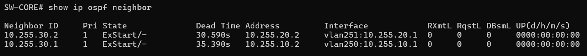
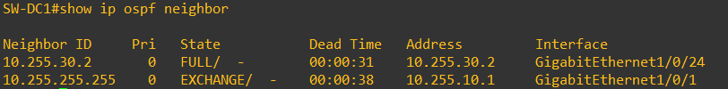
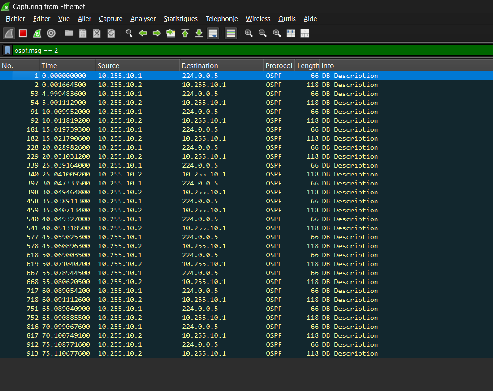
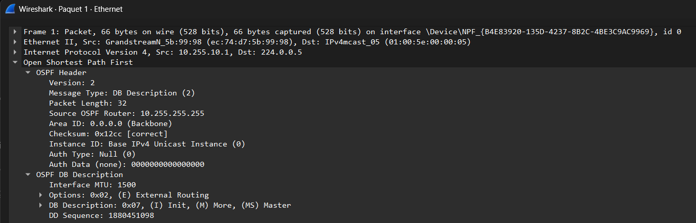
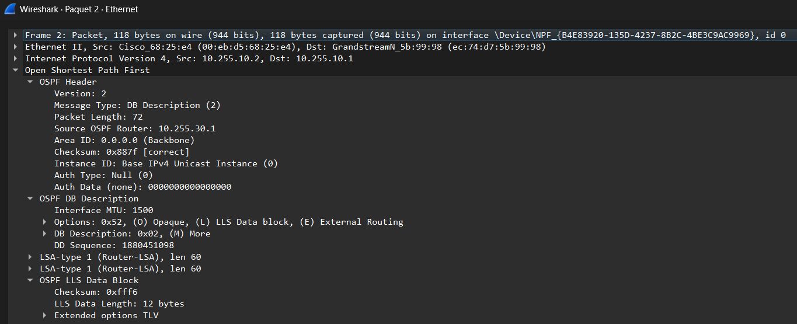
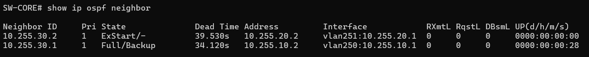
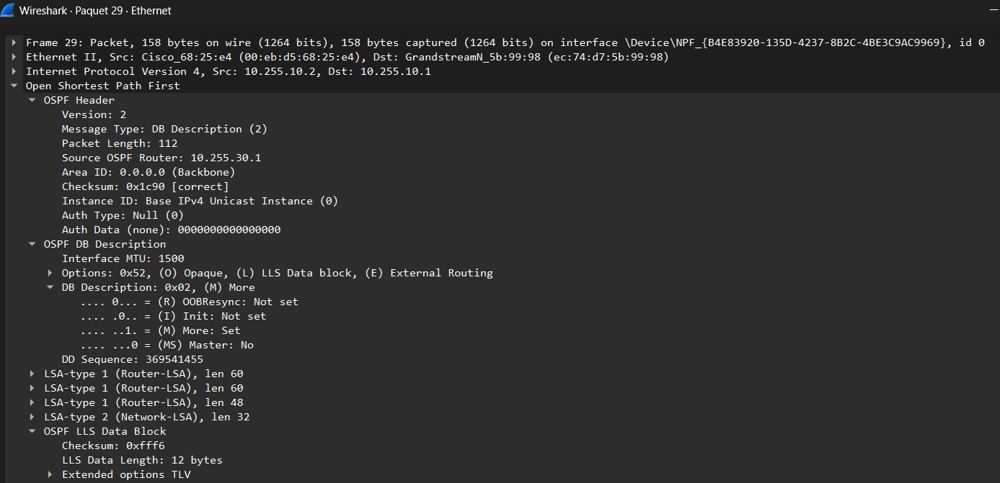
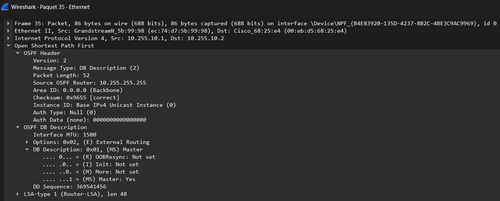
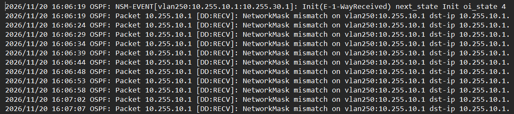

# 🔧 Troubleshooting — OSPF Adjacency Stuck in EXSTART/EXCHANGE

**Date:** November 18–24, 2026  
**Environment:** Personal Homelab — Cisco / Grandstream  
**Category:** Networking / OSPF / Interoperability  
**Status:** Open — Workaround validated on VLAN 250  
**Root cause:** Unconfirmed  
**Vendor support:** Grandstream — Reported internally, ticket on hold pending feedback
**Last update:** November 24, 2026

---

## TL;DR

- **Symptom:** OSPFv2 adjacencies between a Grandstream GWN7822P and Cisco Catalyst 3850 switches fail to reach FULL in Point-to-Point mode.
- **Evidence:** Grandstream remains in EXSTART while Cisco alternates between EXSTART and EXCHANGE. Wireshark reveals repeated Database Description (DBD) packets approximately every 5 seconds.
- **Investigation:** IPv4 connectivity, MTU, Hello/Dead timers, LLS, Opaque LSA, Router IDs and topology isolation were tested without resolving the issue.
- **Workaround:** Broadcast/Broadcast successfully establishes a FULL adjacency.
- **Key lead (hypothesis):** The Grandstream log `NetworkMask mismatch … DD:RECV` reports a `dst-ip` equal to the Grandstream's own interface address, which matches the destination of the unicast Cisco DBD seen in the capture. This points to the Grandstream P2P receive path.
- **Vendor follow-up:** Grandstream requested an unfiltered P2P/P2P capture including the initial Hello packets. The test was repeated and the capture sent on November 23; their analysis is pending.
- **Root cause:** Not confirmed. Escalated to Grandstream technical support.

## Quick Timeline

**Investigation Timeline**

| Date | Action |
|---|---|
| Nov 18–19 | OSPF failure investigated: connectivity, parameters, optional features, topology isolation, configuration and packet-level tests (Steps 1–4) |
| Nov 19 | Support ticket opened with Grandstream |
| Nov 23 | Controlled P2P/P2P and Broadcast/Broadcast Wireshark captures recorded and compared (Steps 4–5) |

**Vendor Support Timeline**

| Date | Request and follow-up |
|---|---|
| Nov 20 | Additional diagnostic data requested (One-Click Debug); provided |
| Nov 23 | Lab test shared and configuration comparison requested; reply sent |
| Nov 23 | Repeat of the P2P test requested, with an unfiltered capture including the initial Hello packets; test repeated and capture sent (Step 6); vendor analysis pending |
| Nov 24 | Behavior reported internally by the vendor, to determine whether it is expected with third-party switches; ticket on hold pending feedback |

Only the items in the second table were done at the vendor's request; everything else is independent work.

## 1. Technical Environment

| Device | Model / Firmware | Router ID |
|---|---|---|
| SW-CORE | Grandstream GWN7822P — 1.0.15.137 | 10.255.255.255 (10.255.0.1 until the Nov 20 debug archive) |
| SW-DC1 | Cisco Catalyst 3850 — IOS XE 16.12.8 | 10.255.30.1 |
| SW-DC2 | Cisco Catalyst 3850 — IOS XE 16.12.8 | 10.255.30.2 |

OSPFv2, Area 0.

| Link | Subnet | Interfaces |
|---|---|---|
| GS ↔ DC1 | 10.255.10.0/30 | GS VLAN 250 ↔ DC1 Gi1/0/1 |
| GS ↔ DC2 | 10.255.20.0/30 | GS VLAN 251 ↔ DC2 Gi1/0/2 |
| DC1 ↔ DC2 | 10.255.30.0/30 | Gi1/0/24 ↔ Gi1/0/24 |

**Expected behavior:** OSPF adjacencies should reach FULL, allowing the routers to synchronize their Link-State Databases.

## 2. Problem Description

With Point-to-Point configured on both sides, the neighbors discover each other but fail during the DBD negotiation.

| Device | OSPF State |
|---|---|
| Grandstream | EXSTART |
| Cisco | EXSTART / EXCHANGE (alternating; depends on the router IDs, see Step 4) |
| Cisco ↔ Cisco reference | FULL |

IPv4 connectivity remains functional, with successful bidirectional ping tests.

**Impact:** OSPF adjacency establishment between Grandstream and Cisco is unsuccessful in P2P mode.

**Evidence — Neighbor states**

*Figure 1 — Grandstream neighbor stuck in EXSTART.*

*Figure 2 — Cisco neighbor not reaching FULL (EXSTART/EXCHANGE) while the Cisco-to-Cisco adjacency is FULL.*

## 3. Troubleshooting Investigation

Steps 1–5 are independent investigation work. Step 6 was requested by Grandstream support.

### Step 1 — Verify Connectivity and OSPF Parameters

**Hypothesis:** IP connectivity or OSPF configuration mismatch.

**Tests performed:** Bidirectional ping, IP/subnet verification, interface states, Area ID, Hello/Dead timers and MTU.

**Observations:**
- IPv4 connectivity successful.
- Both interfaces use a `/30` subnet.
- MTU: 1500 bytes.
- Area: 0.
- Hello/Dead: 10/40 seconds.
- Cisco-to-Cisco P2P adjacency reaches FULL.

**Conclusion:** No basic connectivity or timer mismatch identified.

### Step 2 — Test MTU and Optional OSPF Features

**Hypothesis:** An MTU check or optional OSPF feature prevents database synchronization.

| Test performed | Observation |
|---|---|
| `ip ospf mtu-ignore` | No improvement |
| Disable LLS | No improvement |
| Disable Opaque LSA | No improvement |
| Change Grandstream Router ID | No improvement |
| Restart OSPF processes | No improvement |

LLS deactivation was also verified through Wireshark by observing the modified Cisco OSPF Options and disappearance of the LLS data block.

**Conclusion:** None of these modifications resolved the adjacency failure under the tested conditions.

### Step 3 — Isolate the Topology

**Hypothesis:** Another OSPF link or the triangular topology interferes with adjacency formation.

**Test:** Isolate SW-DC2 and test Grandstream ↔ SW-DC1 independently.

**Result:** P2P adjacency still fails.

**Conclusion:** The failure is reproducible without the full triangular topology.

### Step 4 — Analyze P2P/P2P DBD Exchange

Wireshark was used to inspect OSPF traffic through port mirroring.

**Observed DBD packets:**

| Field | Grandstream | Cisco |
|---|---|---|
| Destination | 224.0.0.5 | 10.255.10.1 |
| Interface MTU | 1500 | 1500 |
| Options | 0x02 | 0x52 |
| DBD Flags | 0x07 (I/M/MS) | 0x02 (M) |
| DD Sequence | 1880451098 | 1880451098 |

The Grandstream acts as DBD master, consistent with its router ID (10.255.255.255) being higher than the Cisco router ID (10.255.30.1). The Cisco DBD is sent as **unicast** to the Grandstream interface address, while the Grandstream DBD is sent to the AllSPFRouters multicast address.

Approximately five seconds later, the exchange repeats: the Grandstream retransmits its initial DBD and the Cisco DBD reply shows the same relevant values.

**Evidence — Repeated DBD exchange**

*Figure 3 — Repeated DBD exchanges approximately every five seconds.*

*Figure 4 — Grandstream initial DBD, flags 0x07.*

*Figure 5 — Cisco DBD response, flags 0x02, matching sequence number.*

**Observation:** Cisco transmits a DBD response, but the Grandstream continues retransmitting its initial DBD.

**Conclusion:** The observed negotiation does not progress beyond the DBD exchange. The reason remains undetermined.

**Note — dependence on router IDs:** The neighbor state seen on Cisco depends on which router is DBD master (the one with the higher router ID). Inferred from the router IDs:

- With the earlier Grandstream router ID (10.255.0.1, lower than 10.255.30.x), Cisco is master and both sides stay in EXSTART.
- With 10.255.255.255, the Grandstream is master: Cisco moves to EXCHANGE and answers, then is expected to fall back to EXSTART when the Grandstream retransmits its initial DBD (RFC 2328, §10.6). This fallback was not directly verified.

In both configurations the Grandstream stays in EXSTART.

### Step 5 — Compare OSPF Network Types

Four combinations were tested:

| Grandstream | Cisco | Result |
|---|---|---|
| Point-to-Point | Point-to-Point | Failed |
| Point-to-Point | Broadcast | Failed |
| Broadcast | Point-to-Point | FULL |
| Broadcast | Broadcast | FULL |

The combinations reaching FULL share one characteristic: Grandstream uses Broadcast.

Mixed network types (Grandstream Broadcast / Cisco Point-to-Point) reached FULL during testing but are not recommended: both ends of a link should use the same network type. The workaround in section 5 therefore uses Broadcast on both sides.

A new Broadcast/Broadcast capture was recorded on November 23.

**Observed DBD negotiation:**

| Packet | Device | Flags | DD Sequence |
|---|---|---|---|
| 26 | Cisco | 0x07 | 3868 |
| 28 | Grandstream | 0x07 | 369541455 |
| 29 | Cisco | 0x02 | 369541455 |
| 35 | Grandstream | 0x01 | 369541456 |

Unlike the failing P2P scenario, the Grandstream increments the sequence number and the exchange progresses.

LSR, LSU and LSAck packets are subsequently observed.

**Evidence — Successful negotiation**

*Figure 6 — Grandstream reports FULL/Backup.*

*Figure 7 — Cisco DBD reply using sequence 369541455.*

*Figure 8 — Grandstream increments the sequence to 369541456.*

**Conclusion:** Broadcast/Broadcast successfully completes the negotiation and LSDB synchronization. The difference strongly associates the failure with the Grandstream P2P configuration, without establishing a root cause.

### Step 6 — Repeat the P2P/P2P Test with an Unfiltered Capture (requested by Grandstream)

Grandstream support asked for the test to be repeated and for the unfiltered packet capture, including the initial Hello packets.

**Method:**
- Both ends in Point-to-Point (Grandstream VLAN 250 ↔ SW-DC1 Gi1/0/1).
- Port mirror (rx + tx) of the Grandstream port connected to SW-DC1.
- Both OSPF interfaces shut down, capture started, then both interfaces brought back up (`shutdown`, capture start, `no shutdown`), so that the link-up sequence and the first Hello packets are included.
- No OSPF filter. A capture filter excluded only the capturing PC's own IP traffic.
- Duration: about four minutes (November 23, 18:18:58 to 18:23:14, UTC+1).

**Status:** The unfiltered capture and the CLI outputs were sent to Grandstream on November 23. The analysis is left to the vendor; no observations are published here until they respond.

## 4. Root Cause Analysis

**Confirmed:**
- The P2P adjacency fails during database exchange.
- IPv4 connectivity is functional.
- DBD retransmissions occur approximately every five seconds.
- Broadcast/Broadcast reaches FULL.
- LLS and Opaque options are also present in a successful Broadcast negotiation, so their presence alone does not explain the failure.

**Additional observation:**

Grandstream diagnostic logs reported:

`NetworkMask mismatch on vlan250`

associated with `DD:RECV`.

This is unusual because an OSPFv2 DBD packet does not include a Network Mask field.

In the One-Click Debug archive of November 20 (router ID 10.255.0.1), this message appears 929 times, roughly every five seconds per link. It disappears during the Broadcast test window (17:22–17:30, device time) and returns as soon as P2P is re-enabled.

**Correlation with the packet capture (hypothesis):**

The log reports `dst-ip 10.255.10.1`, which is the Grandstream's own VLAN 250 address. In the P2P capture (Step 4), the Cisco DBD is sent as unicast to 10.255.10.1. The logged DD:RECV event may correspond to the unicast DBD observed in the packet capture. This correlation remains unconfirmed.

RFC 2328 states that, on point-to-point networks, a sender uses AllSPFRouters as the IP destination (§8.1), so the Cisco unicast deviates from this rule. A receiver, however, must accept packets addressed to its own interface address (§8.2). In Broadcast mode, the Grandstream accepts the same kind of unicast DBD from Cisco, so the rejection appears specific to the Grandstream P2P receive path.

This remains a hypothesis: the log does not print the packet contents.

**Suspected:** An interoperability issue or unexpected DBD processing behavior when Grandstream operates in P2P mode.

**Unconfirmed:** Whether the device rejects received DBD packets, encounters an internal validation issue, or is affected by a firmware defect.

**Root cause: Not confirmed.**

## 5. Corrective Actions

**Validated workaround:** Set OSPF Network Type to Broadcast on the Grandstream VLAN 250 and Cisco Gi1/0/1.

The existing `/30` subnet was retained.

The Cisco-to-Cisco link remains Point-to-Point.

The workaround changes OSPF behavior, including DR/BDR election. It is not a confirmed fix for the underlying issue.

**VLAN 251 ↔ DC2 (Gi1/0/2):** the workaround had not been applied at last verification. If the link is needed, apply Broadcast on both ends.

## 6. Validation and Current Status

| Check | Result |
|---|---|
| GS VLAN 250 ↔ DC1 Broadcast | FULL |
| GS elected DR | Confirmed |
| DC1 elected BDR | Confirmed |
| DBD sequence progression | Confirmed |
| LSR / LSU / LSAck exchanges | Observed |
| GS VLAN 251 ↔ DC2 P2P | Still failing at last verification |
| Root cause identified | No |

**Current status:** Workaround validated on VLAN 250. Investigation remains open.

## 7. Grandstream Technical Support

### Support Timeline

| Date | Exchange / Action |
|---|---|
| November 19 | Technical support ticket opened concerning the P2P adjacency failure |
| November 20 | Additional diagnostic information requested, including One-Click Debug |
| November 20 | OSPF process restarted and a new One-Click Debug export generated for investigation |
| November 23 | Grandstream shared a lab test (GWN7822P ↔ GWN7821P, P2P reaching FULL with and without `ip ospf mtu-ignore`) and asked for a parameter-by-parameter configuration comparison |
| November 23 | Reply sent: comparison of IP/mask, area, router IDs, network type, MTU and additional OSPF settings, with running-configs, CLI outputs, GUI screenshots and the November 20 One-Click Debug archive |
| November 23 | Additional P2P and Broadcast packet-level comparisons completed locally |
| November 23 | Grandstream asked to repeat the test and provide the unfiltered PCAP, including the initial Hello packets |
| November 23 | Test repeated in P2P/P2P; unfiltered PCAP and CLI outputs sent |
| November 24 | Grandstream reported the behavior internally to confirm whether it is expected when using third-party switches or an issue; ticket put on hold pending internal feedback |

The Grandstream lab involves two Grandstream switches, so it does not exercise the Cisco peer involved in this issue.

### Technical Information Provided

- Hardware models and firmware versions.
- OSPF configuration and network topology (running-configs of SW-CORE and SW-DC1, CLI outputs).
- EXSTART/EXCHANGE behavior and P2P versus Broadcast results.
- MTU and Router ID information, with GUI screenshots (VLAN MTU 1500, port jumbo frame setting).
- Grandstream `NetworkMask mismatch` / `DD:RECV` messages.
- One-Click Debug diagnostic data (November 20, router ID 10.255.0.1).
- Unfiltered P2P/P2P packet capture (November 23), including the initial Hello packets, with CLI outputs.

### Prepared Locally — Not Yet Sent

- Broadcast/Broadcast FULL capture (November 23).
- LLS and Opaque LSA test results.
- Own packet-level analysis, deliberately not shared: the vendor reviews the raw capture independently.

### Questions Under Investigation

1. Why does the Grandstream remain in EXSTART after the Cisco DBD response?
2. What condition triggers the `NetworkMask mismatch` message associated with `DD:RECV`, given that a DBD has no network mask field?
3. Is a unicast DBD addressed to the Grandstream's own interface IP rejected in P2P mode only, while accepted in Broadcast mode?
4. Is the behavior related to a firmware limitation, interoperability issue or configuration requirement?

### Vendor Response / Follow-up

**Status:** Behavior reported internally by Grandstream (November 24). Ticket on hold pending their feedback.

**Latest vendor request (November 23):** repeat the test and provide the unfiltered PCAP, including the initial Hello packets. Done.

*To be completed following the next vendor response: diagnosis, recommended action, firmware information and test results.*

## 8. Technical Evidence

### Screenshots

- P2P interface configuration and neighbor states.
- DBD retransmissions and packet details.
- Broadcast/Broadcast FULL adjacency.
- Successful DBD sequence progression.
- Grandstream diagnostic logs.

**Log evidence:**

*Figure 9 — Grandstream log from the November 20 One-Click Debug archive (device time, router ID 10.255.0.1): NetworkMask mismatch on DD:RECV roughly every 5 seconds, with dst-ip equal to the Grandstream's own address.*

### Packet Captures

Original Wireshark captures:

- [ospf-p2p-dbd-failure.pcapng](Captures/ospf-p2p-dbd-failure.pcapng)
- [ospf-broadcast-dbd-success.pcapng](Captures/ospf-broadcast-dbd-success.pcapng)

The screenshots illustrate the analysis; the original PCAP files provide the detailed packet evidence.

**Note:** These PCAP files were recorded during an earlier test using a different Grandstream Router ID (`10.255.0.1` instead of `10.255.255.255`). Although the Router ID affects Master/Slave election, the same P2P failure and Broadcast success were reproduced with both Router IDs. This difference does not invalidate the behavior demonstrated by these captures.

Published captures are exported with the display filter `ospf`. The unfiltered P2P/P2P capture sent to Grandstream (`GS-DC1_OSPF-P2P_unfiltered_2026-11-23.pcapng`) and the One-Click Debug archive are not published, since they contain additional non-OSPF link traffic and the full device configuration respectively.

## 9. Lessons Learned

- Successful IP connectivity does not guarantee OSPF adjacency establishment.
- OSPF neighbor states help narrow down the failure stage.
- Packet captures reveal DBD flags, sequence numbers and retransmission behavior.
- Controlled comparisons help distinguish observed facts from suspected causes.
- A validated workaround does not necessarily identify the underlying root cause.
- Escalating a reproducible issue with logs, configuration details and PCAP evidence supports further vendor investigation.
- Cross-referencing a device log with a packet capture (here, the `dst-ip` in the log against the destination of the captured DBD) turns a vague message into a testable hypothesis.
- A neighbor state can change with the DBD master/slave role, which follows the router IDs; record router IDs next to every state screenshot.
- Start the capture before bringing the link up: the initial Hello packets are only visible if the capture is already running, and a vendor may ask for the unfiltered file.

## 10. References and Next Steps

**References:**
- RFC 2328 — OSPF Version 2
- Cisco IOS XE OSPF documentation
- Grandstream GWN7822P documentation
- Grandstream technical support ticket (private)

**Next steps:**
- Review the Grandstream response to the unfiltered capture.
- Confirm that `NetworkMask mismatch` is still logged with router ID 10.255.255.255.
- Test any recommended configuration change or firmware correction.
- Apply the Broadcast workaround to VLAN 251 / DC2 if the link is needed.
- Update the report only when new evidence is available.

---

**Final status: OPEN — Workaround validated — Root cause unconfirmed — Vendor investigation pending.**
